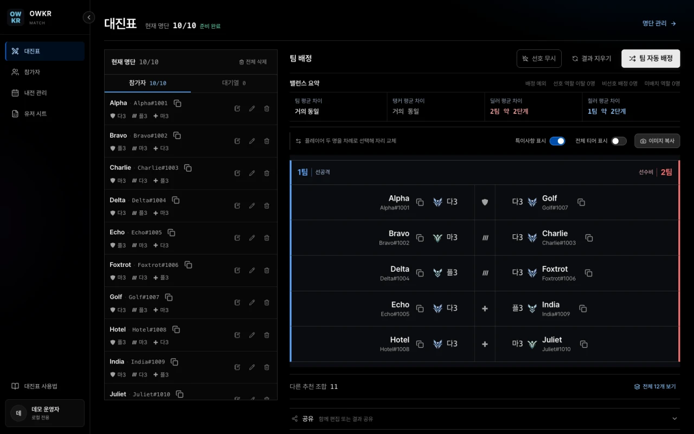
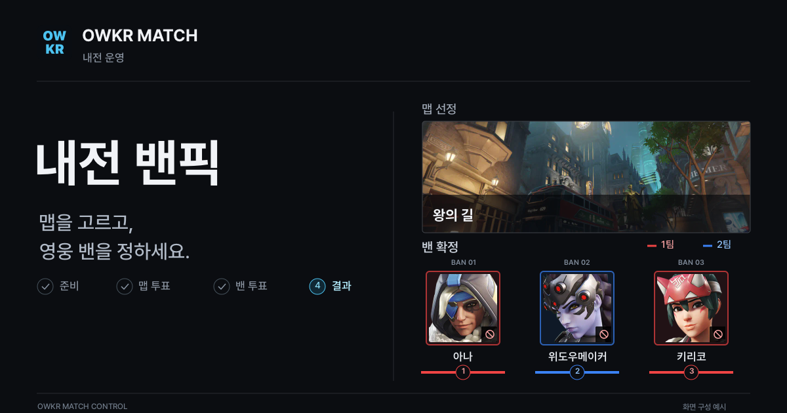

# OWKR Match

Overwatch 2 내전 운영진이 Discord 참가 명단을 정리하고, 역할별 티어와 선호를 반영해 두 팀을 편성하는 도구입니다.

**[OWKR Match 열기](https://owkr-internal-balance.vercel.app/) · [내전 규정](https://overwatch-kr.github.io/owkr-docs/)**

등록된 운영진은 Discord 계정으로 로그인해 이용할 수 있습니다.

*가상 참가자 10명으로 팀 편성을 실행한 화면입니다.*

## 내전 준비부터 결과 공유까지

1. **참가자 등록** · Discord에서 복사한 명단을 붙여넣거나 유저 시트에서 참가자를 가져옵니다. 10명 이후에는 대기열에서 관리합니다.
2. **참여 대조** · Discord 멘션 목록으로 실제 참여자와 등록 명단을 비교합니다.
3. **팀 편성** · 역할별 티어, 선호·비선호 역할과 탱커 티어 차이를 반영해 팀을 배정합니다. 추천 조합을 비교하거나 두 선수를 직접 교체할 수 있습니다.
4. **결과 공유** · 대진표를 이미지로 복사해 Discord에 붙여넣습니다. 다른 운영진과 함께 편집하거나 읽기 전용 결과를 전달할 수도 있습니다.

유저 시트는 운영진이 함께 관리합니다. 공용 특이사항과 작성자만 볼 수 있는 개인 운영 메모를 각각 남길 수 있습니다.

## 영웅 밴픽

운영진이 공유한 밴픽 링크에서 내전 영웅 밴에 참여합니다.

*Discord에 밴픽 링크를 공유했을 때 표시되는 예시입니다.*

## 관련 OWKR 서비스

- [OWKR 문서](https://overwatch-kr.github.io/owkr-docs/) · 내전 규칙과 참가 안내
- [OWKR 관리자 시험](https://owkr-exam.vercel.app/) · 내전 운영진 선발 시험
- [시간을달리는소녀](https://github.com/Overwatch-KR/owkr-gather-bot) · Discord 내전 모집
- [OWKR 내전 워크샵](https://github.com/Overwatch-KR/owkr-scrim-workshop) · 사용자 지정 게임 모드 준비 중
