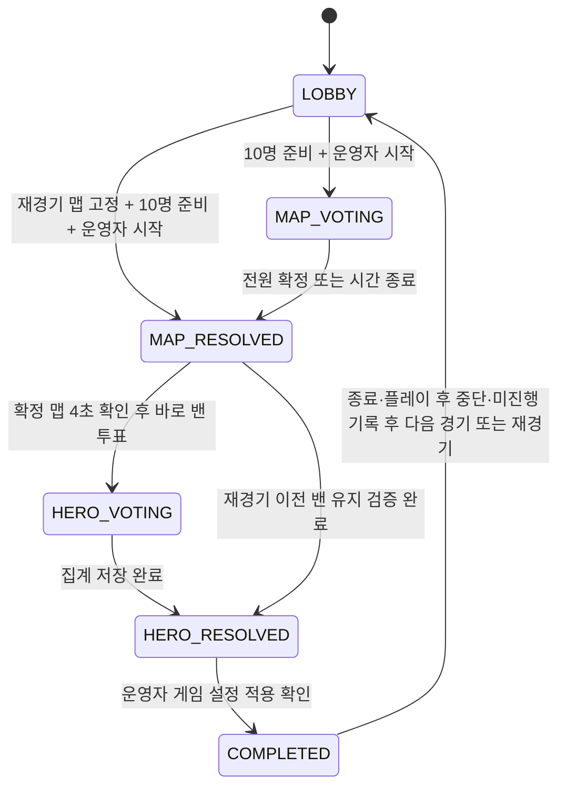
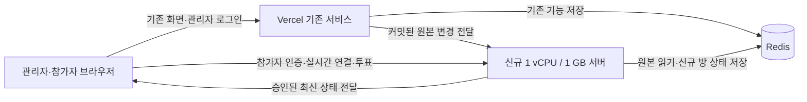

# OWKR Match 실시간 내전 준비 기능명세서

작성일: 2026-10-20 (Asia/Seoul)\
문서 버전: 0.9 / 맵·밴 흐름 반영 (2026-10-21)\
대상: 기존 Vercel 사이트 + 신규 1 vCPU / RAM 1 GB 실시간 서버

> 밸런싱 결과로 내전 방을 만들고, 참가자 10명이 같은 링크에서 최신 팀 구성을 확인한다. 맵 투표를 먼저 진행한 뒤 경쟁전 방식으로 영웅 밴을 결정한다. 일반 밴은 최대 4개이며 5번째 로비 밴은 제공하지 않는다.
> 같은 내전에서 실제 플레이한 맵은 일반 선택·무작위에서 다시 나오지 않는다. 밸런스 조정으로 같은 맵을 다시 진행할 때는 운영자가 해당 경기만의 재경기를 지정하며, 기록 정정과 함께 변경자·사유·변경 전후 값을 남긴다.
>
> 이 문서는 구현 명세다. 현재 사이트에 아래 기능이 구현되었다는 의미는 아니다. ‘공식 규칙’과 ‘OWKR 제품 결정’을 구분하며, 미공개 세부 동작은 공식 게임과 완전히 동일하다고 보장하지 않는다.

## 1. 결정 사항과 범위

### 1.1 기본 결정

| 항목 | v1 기본값 |
| --- | --- |
| 경기 형식 | 5 대 5 역할 고정, 팀마다 탱커 1 / 공격 2 / 지원 2 |
| 참가 방식 | 동일한 방 링크 + Discord 본인 인증 |
| 사이트 진입점 | 운영자·참가자 모두 기존 `owkr-internal-balance.vercel.app` 화면 이용 |
| 운영자 사용 흐름 | 기존 로그인 1회 후 기존 사이드탭의 `대진표` ↔ 신규 `밴픽 운영` 전환, 추가 로그인·다른 사이트 이동 없음 |
| 운영자의 선수 참여 | 명단에 포함된 운영자는 밴픽 운영 화면에서 본인 맵·밴 순위를 직접 선택하고 준비 가능 |
| 운영자의 참가 현황 | 양 팀 10명의 미접속·접속·연결 끊김·입력 연결·단계별 준비/확정 상태를 확인하고 진행 제어 |
| 영웅 선택 UI | 공식 경쟁전 화면을 시각 기준으로 사용: 팀원 목록·역할별 초상화 격자·내 순위 3칸·타이머·초기화/준비 |
| 팀 동기화 | 준비 중 기존 밸런싱 결과를 자동 반영 |
| 시작 조건 | 유효한 배정 10명, 본인 인증한 10명 접속·입력 연결·준비 완료, 원본 동기화 완료 |
| 진행 순서 | 팀 확정 → 맵 투표 → 영웅 밴 투표 → 결과 → 게임 적용 확인 |
| 맵 결정 | 후보 맵 3개 + 무작위 옵션, 압도적 득표 또는 득표 기반 추첨 |
| 맵 중복 | 같은 내전 운영 묶음에서 이미 플레이한 맵은 일반 후보·무작위·전원 기권 추첨에서 제외 |
| 같은 맵 재경기 | 운영자가 이전 경기를 지정하고 사유를 입력한 경우에만 이번 경기에서 허용 |
| 맵 기록 정정 | 운영자만 가능, 수정자 Discord ID·표시 이름·시각·사유·변경 전후 기록 필수 |
| 영웅 밴 | 10명 동시 순위 투표, 1·2·3순위에 7·5·3점 |
| 밴 처리 | 선처리 팀 1개 → 상대 팀 2개 → 선처리 팀 1개 |
| 밴 수 제한 | 전체 최대 4개, 팀당 최대 2개, 역할군당 전체 최대 2개 |
| 5번째 로비 밴 | 항상 비활성화. 설정으로도 켤 수 없음 |
| 선호 영웅 | 제공하지 않음. 맵 확정 후 바로 밴 투표 진행 |
| 기존 기능 | 밸런싱·일반 공유·관리자 공동 편집·기존 내전 투표·설문 동작 유지 |
| 실시간 통신 | 브라우저가 신규 서버와 직접 연결 |
| 상태 저장 | Redis에 새 기능 전용 이름공간으로 저장 |
| 방 유효기간 | 생성 후 최대 3시간, 접속·수정으로 연장하지 않음 |

‘4밴’은 **상한이 4개**라는 뜻이다. 기권·중복·역할 제한·유효 후보 부족 때문에 4개 미만이 될 수 있다. 투표하지 않은 영웅을 임의로 추가해 반드시 4개를 채우지 않는다.

### 1.2 v1 포함 / 후속 확장

| 우선순위 | 포함 내용 |
| --- | --- |
| P0: 최초 출시 | 방 생성·입장, 참가자 인증, 팀 동기화, 준비 확인, 맵 투표, 경쟁전형 4밴, 결과 복사, 같은 방 다음 경기, 내전 단위 맵 중복 방지·밸런스 재경기·기명 기록 정정, 운영자 제어, 재접속·재시작 복구, 만료 |
| P1: 후속 | 승패·시리즈 점수 기록, 기존 내전 기록으로 결과 가져오기, 제한된 관전자 링크 |
| P2: 별도 규칙 | 대표자 수동 밴, 맵 밴·픽, OWCS형 시리즈, 상세 통계 |

v1에 게임 클라이언트 자동 제어, 게임 내 밴 자동 적용, 영웅 선픽 강제, 음성·텍스트 채팅, 마이크 미사용 선택지는 포함하지 않는다. 음성 소통은 기존 Discord를 이용하며 참가자 전원 마이크 필수 정책을 유지한다.

## 2. 공식 규칙 조사와 적용 근거

확인 기준일은 2026-10-20이다. 공개 패치 노트와 규정집은 변경될 수 있으므로 방 생성 시 적용 규칙·카탈로그 버전을 고정한다.

### 2.1 경쟁전 영웅 밴

**10명이 동시에 순위 투표하고, 마감 후 결과를 계산한다.** 7·5·3점과 최신 점수 표시는 [S2], 선처리·동률·처리 순서는 [S1], 초기 경쟁전의 기권·역할 제한·입력 방식은 [S10]에서 확인했다. OWKR의 실행 규칙은 §7에 통합했다.

2026-06-16 변경으로 선호 영웅 -3점과 5번째 로비 밴이 추가되었다. 로비 밴은 양 팀 표를 합치는 별도 슬롯이며 역할군 제한을 넘을 수 있다. **OWKR은 요청에 따라 이 슬롯을 전부 제외한다.** 2026-10-20 재검토에서는 월별 패치 본문 접근 제한을 확인했고, 같은 내용을 공식 Announcements 원문에서 직접 재확인했다. [S2][S13]

공식 경쟁전에서는 밴 단계의 상대 팀을 숨긴다. OWKR은 내전 팀 공유가 목적이고 이미 팀을 알고 입장하므로 팀 명단을 공개하되, 상대의 진행 중 투표 데이터는 서버에서 전달하지 않는다. 이는 OWKR의 의도적인 차이다. [S10]

### 2.2 경쟁전 맵 투표

맵 투표는 영웅 밴 전에 진행된다. 최초 도입 설명은 3개 후보에 대한 득표 비례 추첨을 안내한다. [S3]

2026-04-14에는 무작위 옵션, 6표 차이의 압도적 득표 규칙, 후보 모드 다양성, 개인별 표 비공개가 추가되었다. 2026-10-06에는 최근 2시간 내 마지막 2개 맵의 후보 제외와, 후보 다양성을 계산할 때 호위·혼합을 같은 그룹으로 취급하는 규칙이 안내되었다. 무작위 옵션은 이 최신 후보 제한의 예외다. [S4][S5]

최근 5경기 맵의 재등장 확률을 낮추는 안내도 있으나 정확한 가중치는 공개되지 않았다. OWKR은 게임 계정의 실제 플레이 이력을 가져오지 않으며, 자체 기록만으로 구현 가능한 범위와 미구현 범위를 구분한다. [S2]

**OWKR 적용 규칙은 내전 단위 중복 금지를 우선한다.** 공식 게임의 ‘최근 2시간·마지막 2맵’ 범위보다 강하게, 같은 내전에서 사용한 모든 맵을 제외한다. 공식 무작위 예외도 사용 맵 중복에는 적용하지 않는다. 같은 맵 재진행은 별도의 운영자 재경기 절차로만 허용한다. 이는 사용자 요청에 따른 OWKR 정책이다.

### 2.3 OWCS 대회 규칙은 다른 체계

공식 2026 NA·EMEA 규정집(문서 표기 Updated: 2026.03.19)의 §10.4 및 §10.5를 확인했다. 이 규정은 경쟁전 동시 투표와 구분해야 한다. [S6][S7]

| 구분 | 경쟁전 기반 OWKR v1 | 확인한 2026 OWCS NA·EMEA 규정 |
| --- | --- | --- |
| 밴 결정 | 참가자 동시 순위 투표 | 팀별 지정 밴 절차 |
| 밴 수 | 최대 4개 | 팀마다 1개, 맵당 합계 2개 |
| 역할 제한 | 같은 역할군 최대 2개 | 같은 맵에서 두 밴의 역할군이 달라야 함 |
| 밴 재사용 | 다음 경기 초기화 | 같은 팀은 시리즈에서 같은 영웅을 다시 밴할 수 없음 |
| 선·후밴 | 최고 팀 점수로 결정 | 첫 맵 상위 시드 / 다음 맵 직전 패배 팀이 선택 |
| 맵 | 전원 투표 | 첫 맵 쟁탈, 이후 직전 패배 팀이 맵·모드·시작 진영 선택 |
| 맵 풀 | OWKR 운영자가 승인한 버전 | 스테이지·행사별 Competition Memo로 지정 |

규정집의 세부 맵 순서 표에는 나열된 모드 수와 본문의 숫자가 맞지 않는 부분이 있다. OWCS 전체를 복제할 때는 해당 대회의 최신 Competition Memo까지 재확인해야 한다. 이 문서는 그 표를 보정해 공식 규칙으로 확정하지 않는다. 확인한 NA·EMEA 규칙을 한국·아시아 전체의 공통 규칙으로 간주하지 않는다.

### 2.4 공식 규칙과 제품 결정의 경계

| 항목 | 구분 | 처리 |
| --- | --- | --- |
| 동시 투표·7/5/3·1→2·3→4·역할 최대 2 | 공식 공개 | 기본 채택 |
| 5번째 로비 밴 | 공식 공개 + 사용자 지정 제외 | 미구현 |
| 선호 영웅 -3 | 공식 공개 | 미채택. OWKR은 선호 단계와 점수 차감 없이 맵·밴만 진행 |
| 맵 후보 3 + 무작위·6표 차 | 공식 공개 | 채택 |
| 맵 추첨의 최신 내부 확률 전체 | 미공개 | §6의 명시적 OWKR 공식 사용 |
| 실제 계정별 최근 맵 이력 | 사이트에서 확인하지 않음 | 게임 이력 연동 제외 |
| 내전 전체 사용 맵 제외·무작위에도 중복 금지 | 사용자 지정 정책 | 공식 최근 2맵 정책을 대신해 우선 적용 |
| 밸런스 조정 재경기·기명 정정 | 사용자 지정 정책 | 운영자 명시적 조작과 감사 기록으로 허용 |
| 투표 시간·확정 철회·장애 복구 | 제품 결정 | 본 문서 기본값 적용 |
| 수동 대표자 1→2·3→4 입력 | 별도 제품 규칙 | P2. 경쟁전 모드와 별도 이름 사용 |

## 3. 현재 저장소와의 연결

### 3.1 확인한 현재 구조

| 현재 코드 | 현재 동작 / 신규 기능에 주는 제약 |
| --- | --- |
| `api/match-shares/index.ts` | 일반 공유와 관리자 공동 편집을 제공. 참가자용 밴픽 방 API는 아님 |
| `api/_lib/match-share-store.ts` | 발급 시점의 팀 구성을 저장하는 스냅샷 |
| `api/_lib/match-live-store.ts` | Redis revision으로 공동 편집 충돌 방지, 생성 후 3시간 만료 |
| `src/utils/match-live-polling.ts` | 활동 중 500ms / 대기 중 1,500ms 확인 |
| `api/auth/callback.ts` | 관리자 허용 목록 밖 Discord 계정은 로그인 거절 |
| `src/main.tsx` | 관리자 화면과 `/participate/:token` 공개 참여 경로를 분리 |
| `domains/scrim/shared/model.ts` | 기존 사전 밴 투표·사용 밴·설문·후기 기록 |
| `domains/scrim/shared/heroes.ts` | 기존 영웅 ID·이름·역할 목록. 신규 규칙용으로 최신성 검증 필요 |

현재 관리자 공동 편집 링크를 참가자에게 그대로 배포하지 않는다. 새로운 `/draft/:roomCode` 경로와 별도 참가 권한을 추가한다. 참가자에게 관리자 명단·유저 시트 편집 권한을 부여하지 않는다.

### 3.2 보존하는 동작

- 밸런싱 알고리즘, 점수 계산, 역할 선호·기피·미배치·완전 제외 규칙을 변경하지 않는다.
- 기존 일반 공유 링크의 스냅샷 성격과 유효기간을 변경하지 않는다.
- 기존 관리자 공동 편집을 신규 서버로 옮기거나 기존 폴링 간격을 변경하지 않는다.
- 기존 내전 사전 투표의 집계와 `usedBanHeroIds`를 신규 경기의 투표·밴 결과로 덮어쓰지 않는다.
- 신규 서버 장애가 기존 밸런싱·명단 편집·일반 공유를 실패시키지 않게 한다.

### 3.3 신규 서버로 보내는 데이터

해당 경기의 배정된 10명에 대한 식별자·표시 이름·팀·역할·슬롯과 원본 revision만 보낸다. 티어는 화면에서 필요한 경우에만 선택적으로 포함한다. 관리자 메모·유저 시트 전체·설문·OAuth access token·기존 관리자 세션은 전달하지 않는다.

내부 참가자 식별은 유저 시트 UUID와 Discord ID의 연결을 유지한다. 투표 권한은 인증한 Discord ID와 배정된 Discord ID가 정확히 일치할 때만 부여한다. 배틀태그 또는 표시 이름 일치만으로 참가 권한을 주지 않는다.

## 4. 사용자와 권한

| 역할 | 가능한 작업 |
| --- | --- |
| 방 소유자 | 기존 운영 제어 전체 + 양 팀 참가자 접속/진행 현황 확인 + 공동 운영자 1명 부여·회수. 내전 운영 묶음 생성자가 소유자가 됨 |
| 공동 운영자 | 소유자가 명시적으로 등록한 기존 관리자 1명. 양 팀 참가자 접속/진행 현황, 시작·정지·재개·재경기·기명 정정·종료·만료 후 이력 정리 가능. 다른 운영자 부여·회수·소유권 변경 불가 |
| 운영자이면서 선수 | 같은 밴픽 운영 화면에서 운영 제어 + 본인 준비·맵 투표·밴 순위 선택 및 제출. 참가자 10명 중 본인 1명으로 계산하며 추가 표 없음 |
| A/B팀 참가자 | 본인 준비·맵 표·밴 순위 수정 및 제출, 같은 팀의 허용된 정보 확인 |
| 명단 외 로그인 사용자 | 입장 거절 안내. 본인 등록·팀 선택·다른 사람 대신 투표 불가 |
| 관전자 | P1 전용 읽기 권한. 투표·같은 팀 내부 표 데이터 접근 불가 |

운영자가 선수의 표를 대신 입력하거나 상대 표를 열람하는 기능은 P0에 제공하지 않는다. 문제 해결은 일시정지·투표 재시작·경기 준비 초기화로 처리하고 행위자를 기록한다.

### FR-OPERATOR-01: 소유자와 공동 운영자

- ‘운영자’는 해당 내전 운영 묶음의 소유자 1명과 선택적인 공동 운영자 최대 1명을 뜻한다. 두 권한은 활성 방과 이어가는 방에 승계한다. 기존 사이트의 관리자라는 사실만으로 다른 사람의 방을 제어하거나 이력을 정리할 수 없다.
- 소유자는 기존 관리자 허용 목록에 현재 등록된 Discord ID를 골라 공동 운영자를 부여한다. 서버에서 대상 자격과 소유자 권한을 검증하고 등록자·시각·대상·사유를 남긴다. 대상은 본인의 기존 인증으로 들어와 권한을 확인하며 입장권을 서로 공유하지 않는다.
- 소유자는 공동 운영자를 회수할 수 있다. 부여·회수는 `operatorRevision`을 증가시키며, 모든 제어·갱신·이력 정리 명령은 현재 권한을 다시 검사한다. 회수된 운영자의 남은 토큰만으로 제어할 수 없고 운영 구독을 종료한다. 선수이기도 하면 현재 명단에 따른 일반 참가 권한만 다시 연결한다.
- 다른 공동 운영자를 등록하거나 소유자를 바꾸는 권한은 공동 운영자에게 없다. P0에서는 소유권 이전·전역 관리자의 강제 방 인수를 제공하지 않는다.
- 유효한 운영자 연결이 **모두** 끊기면 진행 중 준비를 자동 정지한다. 소유자만 끊겼어도 공동 운영자가 연결돼 있으면 계속한다. 공동 운영자가 없으면 소유자 단절이 전원 단절이다. 계정별 유효 연결 하나 이상이면 접속으로 세며 사이드탭 이동은 단절이 아니다.
- 공동 운영자 회수·인증 만료로 마지막 유효 운영자가 없어져도 같은 정지 규칙을 적용한다. 다시 접속했다고 자동 진행하지 않고 현재 권한을 가진 운영자가 재개한다. 동시 제어는 기대 revision·명령 중복 방지로 한 번만 반영한다.
- 두 운영자 모두 선수인 경우 각자 본인 표 하나만 갖는다. 선수 명단에 없는 운영자는 투표하지 않는다. 운영자 단절과 해당 선수의 미응답 처리는 각각의 규칙으로 관리한다.

## 5. 방 생성·팀 동기화·준비

### FR-ROOM-01: 실시간 방 만들기

1. 기존 대진표에 `실시간 밴픽 방 만들기` 액션을 추가한다.
2. 배정된 슬롯 10개, 서로 다른 Discord ID 10개, 팀별 역할 인원을 검증한다. 대기자는 포함하지 않는다.
3. 기존 공동 편집 세션이 있으면 해당 원본에 연결한다. 없으면 기존 저장 기능을 이용해 새 원본 세션을 만든다.
4. 생성 요청 중복 방지를 위해 요청 식별자를 사용한다. 같은 요청 재시도로 방이 여러 개 생기지 않는다.
5. 방 링크를 발급한다. 단순 화면 열기로 방이 생성되거나 만료 시각이 갱신되지 않는다.
6. 사용 가능한 원본 세션 시간이 10분 미만이면 원본 세션을 새로 만들도록 안내한다.
7. 처음 만드는 방은 새 `draftSessionId`로 내전 운영 묶음을 만든다. 방을 다시 만드는 경우 운영자가 `기존 내전 이어가기`를 선택하면 같은 묶음의 사용 맵·재경기·정정 기록을 이어받는다. 방 링크·원본 세션·팀 변경만으로 사용 맵 이력을 초기화하지 않는다.

방 만료는 `min(방 생성 + 3시간, 원본 공동 편집 만료, 내전 운영 묶음 만료)`이다. 기존 세션의 만료 정책을 연장하거나 우회하지 않는다. 내전 운영 묶음은 최초 생성 후 24시간 보관하며 이어가기·편집으로 연장하지 않는다. 묶음에는 한 번에 하나의 활성 방만 연결한다. 이어가기 시 이전 방을 닫고 전환을 기록하며, 실제 진행 중인 경기가 있으면 종료·중단 기록을 먼저 요구한다.

`새 내전 시작`은 사용 맵 기록을 승계하지 않는 새 운영 묶음 생성이다. 기존 내전이 있으면 ‘새 내전은 이전 사용 맵을 제한하지 않음’을 확인 화면에 표시하고 생성자를 기록한다. 같은 내전의 중복 제한을 풀기 위한 조용한 전체 기록 삭제 기능은 제공하지 않는다.

### FR-ROOM-02: 참가자 입장

- 링크 진입 → 방 존재·만료 확인 → 참가자 전용 Discord 인증 → 명단 대조 → 본인 팀에 자동 입장한다.
- 운영자·일반 참가자 모두 기존 Vercel 사이트의 화면을 이용한다. 일반 참가자는 이 화면의 `Discord로 참여`를 누르면 신규 서버가 처리하는 인증을 거쳐 원래 방 화면으로 돌아온다. 신규 서버의 별도 운영 사이트를 직접 방문할 필요는 없다.
- 기존 사이트에 로그인한 운영자는 제한된 서명 입장권으로 신규 서버 세션을 자동 생성한다. 운영자가 선수이기도 하면 같은 Discord ID로 본인 참가 권한을 함께 확인하므로 별도의 참가자 로그인을 반복하지 않는다.
- 기존 관리자 OAuth 경로를 일반 참가자에게 개방하지 않는다. 신규 서버의 별도 참가자 OAuth 경로를 사용한다.
- 이름을 선택해서 본인이라고 주장하는 방식은 허용하지 않는다.
- 입장 대기 중에는 최소한의 방 정보만 표시하고 전체 명단은 인증·명단 대조 후 제공한다.
- 같은 방의 한 Discord ID는 마지막으로 연결한 탭의 웹소켓 하나만 유지한다. 새 연결의 인증·저장이 성공한 뒤 기존 연결을 종료하고 쓰기 권한을 회수한다. 기존 탭은 자동 재접속과 인증 갱신을 중지하며, 사용자가 명시적으로 다시 연결한 경우에만 연결을 가져온다. 준비·저장·확정 상태는 같은 참가자 정보로 유지한다.

### FR-ROOM-03: 준비 중 팀 변경 자동 반영

- 기존 원본 세션을 팀 구성의 기준으로 삼고, 신규 서버의 팀 사본을 별도로 편집하지 않는다.
- 공동 편집 저장 성공 후 **커밋된** 스냅샷과 revision을 새 연동 경로로 전달한다. 저장 전 브라우저의 임시 드래그 상태는 반영하지 않는다.
- 정상 전달은 즉시 통지하며, 실패한 전달은 새 기능 전용 보관함에 남겨 신규 서버가 재수신한다. 기존 저장 요청의 성공 여부는 바꾸지 않는다.
- 보관함 재확인은 신규 서버가 Redis에서 수행하며, 참가자별 Vercel 폴링을 추가하지 않는다. 새 전달 경로와 보관함 저장 자체가 실패한 경우에도 시작 직전 원본 재확인으로 누락을 차단한다.
- 이미 적용한 revision 이하의 늦은 메시지는 무시한다. revision 불연속·해시 불일치는 원본을 다시 읽어 맞춘다.
- 원본 갱신 시 준비 체크를 10명 모두 해제한다. 퇴장 대상은 다음 조회·이벤트부터 명단과 내부 투표 정보를 받을 수 없다.
- 유효한 10인 배정이 깨지면 `팀 배정 확인 필요`를 표시하고 시작을 막는다.

초기 연동은 동일 Redis의 기존 원본을 서버에서 읽을 수 있는 범위로 구현하되, 원본 키에 대한 쓰기는 기존 API만 수행한다. 새 서버는 신규 상태 키에만 쓴다. 시작 확정은 FR-ROOM-04의 같은 원자 실행 범위를 필수로 하며, 조회 인터페이스만 추가해 저장소를 분리하는 것은 허용하지 않는다.

### FR-ROOM-04: 시작과 이후 원본 변경

- `draft.start`와 `game.markStarted`는 각각 **원본 revision 검증과 해당 시작 상태 저장을 동일 저장소의 하나의 원자적 처리로 수행**한다. 원본 조회 응답을 받은 뒤 별도 쓰기로 시작하는 절차는 허용하지 않는다.
- P0에서는 기존 원본 키와 신규 방·경기·내전 이력·명령 처리 키를 같은 Redis의 동일 원자 실행 범위에 둔다. 신규 서버의 시작용 원자 연산이 실제 원본 키를 읽어 기대 revision·배정 해시·원본 유효기간을 검사하고, 신규 시작 상태·고정 명단·revision·명령 처리 결과를 함께 저장한다. 신규 서버는 기존 원본을 수정하지 않는다.
- 기존 API의 원본 변경과 신규 시작 연산은 저장소가 실행한 순서로 판정한다. **원본 변경이 먼저 저장됐으면 시작을 거절**한다. 시작이 먼저 저장되고 이후 원본이 바뀌면 아래의 변경 후 중단·다음 경기 정책을 적용한다. 늦은 이벤트나 브라우저의 로컬 잠금은 이 순서를 대체하지 못한다.
- 원자 처리에서 명단·현재 운영 권한·확인된 준비 상태·방/내전 만료·설정·경기 세대·맵 이력 revision도 검사한다. 실제 경기 시작은 준비 완료와 맵 사용 가능 여부까지 검사해 `PLAYING`·실제 시작 기록·사용 맵 집합을 함께 저장한다. 접속 정보는 같은 방 처리 문맥에서 확인하고 운영자 전원 단절 상태에서는 시작하지 않는다. 준비 시작 시 현재 명단 10명의 유효한 입력 담당 연결과 준비가 모두 있어야 하며, 미접속·입력 연결 없음·미준비 인원을 FR-ADMIN-03에 따라 안내한다.
- 원본이 없거나 만료됐거나 기대 revision과 다르면 시작을 거절하고 다시 동기화한다. 성공 시 원자 처리에서 읽은 명단·역할·원본 revision·규칙·카탈로그를 경기 스냅샷으로 고정한다.
- 원본과 신규 상태가 다른 저장소·다른 원자 실행 범위에 놓이는 배포는 P0에서 지원하지 않는다. 저장소를 분리하려면 기존 원본 쓰기 경로까지 참여하는 별도 조정 계약을 먼저 설계해야 하며, 조회 후 저장·프로세스 내부 잠금으로 대신하지 않는다.
- 준비 흐름을 시작한 뒤 실제 플레이 전 더 최신 원본이 발견되어도 진행 중 팀을 즉시 교체하지 않는다. `명단 변경으로 중단` 상태로 전환하고 투표·실제 시작을 막는다.
- 운영자가 `최신 팀으로 준비 다시 시작`을 실행하면 해당 경기의 맵·표·밴 결과를 폐기하고 준비 단계로 돌아간다. 기존 결과는 취소 이력으로 구분해 남긴다.
- 이 초기화는 내전 운영 묶음의 사용 맵 기록을 지우지 않는다. 명시적으로 설정한 재경기 계획이 있으면 대상 맵·사유만 보존하고, 최신 팀으로 재확인한 뒤 10명의 준비를 다시 받는다. 이전 팀의 투표는 가져오지 않는다.
- 원본 변경을 무시하고 기존 경기로 계속하는 기능은 P0에 제공하지 않는다.
- 이미 실제 플레이를 시작한 경기의 고정 명단은 이후 대진표 수정으로 덮어쓰지 않는다. 변경은 다음 경기 준비에 적용하고, 현재 경기를 재진행하려면 종료·플레이 후 중단을 기록한 뒤 재경기 절차를 사용한다.

## 6. 맵 선택

### 6.1 카탈로그와 후보 풀

경쟁전 기반 기본 모드는 쟁탈(Control), 혼합(Hybrid), 호위(Escort), 밀기(Push), 플래시포인트(Flashpoint)다. 격돌(Clash), 점령(Assault), 스타디움 전용·아케이드 맵은 기본 풀에서 제외한다. OWCS 규정집의 모드 목록과 공식 Clash 변경 기록을 참고하되, 이는 OWKR의 기본 풀 정책이다. 한국어 모드 이름은 공식 한국어 안내를 따른다. [S7][S8][S11][S12]

카탈로그의 각 맵은 `mapId`, 한국어·영문 이름, 모드, 후보 다양성 그룹, 시작 진영 유무, 활성 여부, 검증 일자·출처, 이미지 선택값을 가진다. 호위와 혼합의 다양성 그룹은 동일하게 둔다. 이름 문자열을 영구 식별자로 사용하지 않는다.

전체 최신 맵 목록이나 대회 특정 스테이지 풀을 이 문서에서 확정하지 않는다. 출시 전에 운영자가 현재 사용자 지정 게임에서 이용 가능한 목록을 승인한 `mapCatalogVersion`을 배포해야 한다. 신규 맵·중단된 맵·변형 맵을 자동 추가하지 않는다. 후보 카탈로그 변경은 기존 방에 소급하지 않는다.

### 6.2 내전 단위 중복 금지

- 중복 판단 단위는 같은 `draftSessionId`다. 팀·역할·참가자 교체, 새 경기 번호, 방 재생성으로 사용 이력을 초기화하지 않는다. 다른 내전 운영 묶음에는 사용 이력을 적용하지 않는다.
- `사용 맵 집합`은 해당 묶음에서 **실제 경기를 시작한 기록**이 하나 이상 있는 맵 ID의 집합이다. 최근 2시간·최근 2개만 보는 제한은 사용하지 않는다.
- 서버가 후보와 모든 추첨 경로에서 사용 맵을 제외한다. 일반 맵 지정 API로 사용 맵을 직접 전달해도 거절한다.
- 맵 투표로 정했거나 게임 설정을 적용했지만 실제 플레이 전 취소했다면 사용 맵으로 세지 않는다. 반대로 플레이 후 밸런스 문제로 결과를 무효 처리해도 사용 기록은 남는다.
- 운영자가 `실제 경기 시작`을 기록할 때 사용 처리한다. 시작 기록 없이 `실제 경기 종료`를 누르면 같은 처리에서 시작·사용 기록도 함께 보완한다. 실제 실행 여부는 운영자가 확인한다.
- 실제 시작 명령을 다시 보내도 같은 gameId에 사용 기록을 중복 생성하지 않는다. 재경기는 새 gameId로 별도 사용 사실을 남긴다.
- 동일 맵을 재경기로 여러 번 플레이했어도 사용 맵 집합에는 하나의 맵으로 남는다. 특정 경기 기록 하나를 정정하더라도 다른 실제 플레이 기록이 있으면 그 맵은 계속 제외한다.
- 정식 맵과 계절 장식 등 같은 맵의 변형은 `canonicalMapId`가 같으면 같은 맵으로 판단한다. 이름이나 이미지가 다르다는 이유로 중복 제한을 우회하지 않는다.
- 예외는 FR-MAP-05의 **이번 재경기 한정 승인**뿐이다. ‘중복 허용’을 전체 내전에 켜 두는 설정은 P0에 제공하지 않는다.

### FR-MAP-01: 후보 생성

1. 방에서 승인한 활성 맵 풀에서 해당 내전의 사용 맵과 운영자가 이번 내전에서 제외한 맵을 뺀 `일반 진행 가능 풀`을 만든다. 여기서 서로 다른 맵 3개를 뽑는다.
2. 보이는 후보에는 다양성 그룹이 최소 2개 있어야 한다. 호위·혼합만으로 3개를 채울 수 없다.
3. 첫 경기부터 마지막 경기까지 같은 내전의 사용 맵 집합을 적용한다. 다른 내전에서 플레이한 맵은 제외 근거로 사용하지 않는다.
4. 무작위 결과 풀은 `일반 진행 가능 풀 - 보이는 후보 3개`다. **무작위에서도 이미 사용한 맵은 나오지 않는다.** 공식 게임의 최근 맵 예외와 구분되는 OWKR 정책이다.
5. 기본 진행은 후보 3개 + 무작위가 모두 유효해야 하므로, 일반 진행 가능 풀 크기 최소 4개·다양성을 시작 시 검증한다.
6. 남은 맵이 1~3개면 ‘남은 맵으로 진행’을 명시적으로 선택해 남은 맵만 표시하고 무작위 옵션은 제거한다. 1개면 그 맵으로 진행할 것을 10명에게 알리고 준비 후 확정한다. 맵 수와 무관하게 다양성을 충족하지 못하면 운영자가 이번 경기의 다양성 예외와 사유를 확인한다. 어느 경우도 사용 맵을 일반 후보로 다시 넣지 않는다.
7. 조건을 만족하는 후보 조합 가운데 균등 추첨한다. 원본 게임의 미공개 후보 생성 가중치를 복제한다고 표시하지 않는다.
8. 서버가 후보를 한 번 생성해 저장한 뒤 전달한다. 새로고침·재접속·새 기기 연결로 다시 추첨하지 않는다.
9. 일반 진행 가능 맵이 0개면 진행을 막고 ‘미사용 맵 풀 확장’, ‘이전 맵 재경기’, ‘내전 종료’를 제공한다. 자동으로 사용 맵 목록을 초기화하거나 전체 맵을 다시 추첨하지 않는다.

게임의 실제 최근 플레이·선호도 기반 추천, 최근 5경기 재노출 가중치는 P0에서 구현하지 않는다. 사이트에서 기록하는 이번 내전의 사용 맵으로 중복을 제한한다.

### FR-MAP-02: 투표와 마감

- 참가자는 제시된 맵 또는 무작위 중 하나에 투표하거나 기권한다. FR-MAP-01의 후보 부족 모드에서는 표시된 맵만 선택할 수 있고 무작위는 없다.
- 제출 전에는 변경 가능하다. `준비`를 누르면 확정되며 P0에서는 다시 변경할 수 없다. 이 확정 방식은 OWKR 정책이다.
- `준비` 명령은 최종 맵 선택 또는 명시적 기권 전체와 기대 `ballotRevision`을 담는다. 최종 선택 저장과 잠금은 한 번에 수행하며, 앞선 임시 저장이 끝났다는 가정으로 이전 표만 잠그지 않는다. 빠른 변경·진행 중 저장·마감과의 순서는 §12.4를 따른다.
- 확정하지 않았더라도 서버가 저장을 승인한 최신 선택은 마감 시 유효표다. 아무 선택도 저장되지 않았으면 기권이다.
- 개별 선택과 작성 중 상태는 본인에게만 반환한다. 양 팀과 운영자에게는 옵션별 합계·확정 인원만 보이고, ‘누가 어느 맵을 선택했는지’는 보내지 않는다.
- 10명 확정 또는 서버 제한시간 종료 시 마감한다. 접속이 끊긴 참가자의 저장된 표는 유지한다.
- 진행 중 6표 차이가 나도 즉시 마감하지 않고, 정해진 마감 시 최종 표에 압도적 득표 규칙을 적용한다. 조기 종료 시점은 OWKR 정책이다.

### FR-MAP-03: 맵 결정

마감된 옵션별 득표수를 `v[i]`라고 한다. 기권은 분모에 포함하지 않는다.

1. 최다 득표 옵션이 다른 모든 옵션보다 6표 이상 앞서면 그 옵션을 확정한다. 이는 ‘6표 이상 받으면 무조건 확정’이 아니다. [S4]
2. 그렇지 않고 유효표가 있으면 `P(i) = v[i] / 유효표 합계`로 한 번 추첨한다. 이는 공개된 초기 원리를 사용하는 OWKR 공식이며 최신 게임의 내부 확률 전체를 재현한다는 뜻은 아니다. [S3]
3. 전원 기권이면 해당 단계 시작 시 고정한 `일반 진행 가능 풀`에서 균등 추첨한다. 후보 부족 모드에서는 표시된 남은 맵 중에서 추첨한다. **기권 때문에 이미 사용한 맵을 되살리지 않는다.** 이 경우의 정확한 풀은 OWKR 정책이다.
4. 무작위 옵션이 선택되면 사전에 고정한 무작위 결과 풀에서 균등 추첨한다.
5. 후보·표 합계·판정 방식·추첨 결과·추첨 식별자를 원자적으로 저장한다. 재시도로 재추첨하지 않는다.
6. 맵 결과는 영웅 밴 전과 진행 중에 계속 표시한다.

검산 예시: `8:2:0:0`은 6표 차이로 확정, `7:2:1:0`은 5표 차이로 추첨, `6:0:0:0 + 기권 4`는 6표 차이로 확정, `5:5:0:0`은 두 후보 각각 50% 추첨이다.

### FR-MAP-04: 시작 진영

- 호위·혼합은 후보 생성 시 A팀의 최초 공격·수비를 서버가 무작위로 정하고 맵 카드에 미리 표시한다. B팀은 반대다. 이 추첨 방식은 OWKR 정책이다.
- 무작위 옵션으로 정해진 맵은 실제 맵 확정 시 진영을 한 번 정해 저장한다.
- 쟁탈·밀기·플래시포인트에는 공격·수비 선택 UI를 표시하지 않는다.
- ‘첫 공격’은 경쟁 규칙의 시작 진영이며 한 경기 내내 그 진영만 한다는 의미가 아니다.
- 사이트의 A/B팀과 게임 로비의 1/2팀 대응을 운영자 결과 화면에 명시한다.

### FR-MAP-05: 밸런스 조정 등을 위한 같은 맵 재경기

재경기는 일반 후보 풀의 중복 제한을 푸는 설정이 아니라, **이전 경기와 맵을 지정한 새로운 경기**다. 원래 경기의 명단·맵·밴·기록을 덮어쓰지 않는다.

1. 운영자가 이력에서 이전 경기를 선택하고 `이 맵으로 재경기`를 누른다. 진행 중인 실제 경기가 있으면 ‘종료’ 또는 ‘플레이 후 중단’을 먼저 기록한다. 진행 중인 새 밴픽이 있으면 취소를 먼저 요구한다.
2. 사유는 `밸런스 조정`, `접속/서버 문제`, `게임 설정 오류`, `기타` 중 선택하며, 상세 사유를 필수 입력한다. 재경기 번호와 원 경기 연결을 만든다.
3. 밸런스 조정은 **기존 대진표에서** 수행한다. 신규 서버에서 팀을 별도로 고치지 않고 최신 원본 revision을 받아 새 경기 명단으로 고정한다.
4. 참가자 전원에게 ‘재경기 / 대상 맵 / 사유 / 변경된 팀·역할 / 밴 처리·진영’을 표시하고 10명의 준비를 새로 받는다. 일반 참가자는 예외를 발급하거나 승인 대상을 바꿀 수 없다.
5. 이번 경기에서만 대상 맵을 고정하고 맵 투표를 건너뛴다. 준비가 끝나면 대상 맵의 선택 결과를 저장하고 영웅 밴 단계로 진행한다.
6. 영웅 밴은 **다시 투표**가 기본이다. 운영자는 ‘이전 확정 밴 유지’를 명시적으로 선택할 수도 있다. 유지할 때는 현재 카탈로그에서 모든 영웅이 활성인지, 최대 4명·역할군 최대 2명 등 현재 규칙에 맞는지 검사한다. 맞지 않으면 다시 투표해야 한다. 원 경기의 개인 표는 복제하지 않는다.
7. 첫 공격·수비는 ‘이전 A/B팀 진영 유지’가 기본이며 운영자가 ‘A/B팀 진영 교환’을 선택할 수 있다. 최소 경기 기록에 저장한 최초 공격 팀과 원 경기 맵 카탈로그 버전을 사용한다. 팀원이 바뀌어도 진영은 새 A/B팀 기준이다. 공격·수비가 없는 모드에서는 이 옵션을 표시하지 않는다. 구형 기록에 필요한 값이 없으면 임의로 추정하지 않고 운영자가 진영을 명시해 사유를 남긴다.
8. 예외는 `draftSessionId + 새 gameId + epoch + 원 gameId + canonicalMapId`에 묶는다. 다른 맵·다른 경기·만료 후 명령에 재사용할 수 없다. 대상 맵은 현재 승인된 활성 맵이어야 하며, 운영상 제외된 맵이면 FR-MAP-07에서 먼저 제외를 해제해야 한다.
9. 중복 명령·재접속·서버 재시작으로 재경기가 두 개 생성되거나 예외가 전체 허용으로 바뀌지 않는다. 재경기 취소 시 예외를 폐기한다. 팀 변경으로 준비를 다시 하는 경우 의도만 보존하고 새 epoch로 재확인한다.
10. 재경기가 끝나도 원래 사용 맵 제한은 유지된다. 같은 맵을 또 하려면 운영자가 다시 사유를 남겨 재경기를 만든다.

예: 1경기 왕의 길 플레이 → 밸런스 문제로 결과 무효 → 기존 대진표에서 선수 교체 → `1경기 왕의 길 재경기` → 맵 고정·밴 재투표 → 다음 일반 경기 후보에서는 왕의 길 제외.

### FR-MAP-06: 맵 사용 기록 기명 정정

운영자가 `맵 사용 기록`에서 실제와 다르게 입력한 정보를 정정할 수 있다. 원본 기록은 보존하고 정정 이벤트를 추가해 현재 사용 집합을 다시 계산한다.

| 정정 대상 | 동작 |
| --- | --- |
| 잘못 기록한 맵 | 실제 플레이한 맵으로 정정하고 이전/이후 맵·정정자를 표시 |
| 미진행을 플레이로 잘못 기록 | 실제 플레이 없음으로 정정. 다른 플레이 기록도 없을 때만 해당 맵을 일반 풀에 복귀 |
| 플레이를 미진행으로 잘못 기록 | 실제 플레이로 정정하고 이후 일반 후보·추첨에서 제외 |
| 결과 무효 또는 플레이 후 중단 | 승패 유효성과 사용 여부를 분리. 실제 플레이한 맵은 계속 제외 |
| 예전 정정의 오류 | 새로운 정정으로 바로잡고 앞선 정정까지 이력 유지 |

- 수정자 Discord ID·수정 당시 표시 이름·서버 시각·사유·대상 경기·변경 전후 값·기대 이력 revision을 필수 저장한다. 수정자와 시각은 직접 입력하거나 바꿀 수 없다.
- 기록 수정과 ‘재경기 승인’은 다른 동작이다. 다시 하고 싶다는 이유로 사용 기록을 미진행으로 바꾸는 경로를 안내하지 않는다.
- 운영자에게 전체 정정 이력을 제공한다. 참가자는 맵 선택 화면에서 해당 경기의 정정 여부·변경자 표시 이름·사유·현재 제외 이유를 확인한다. 다른 내전의 기록이나 개인 투표는 공개하지 않는다.
- 정정 결과 사용 맵이 바뀌면 서버에서 풀을 다시 계산하고 모든 연결에 갱신한다. 아직 실제 경기를 시작하지 않은 현재 준비가 있으면 중단하고, 일반 경기는 맵 투표부터 재생성하며 재경기는 대상·예외를 재검증한다. 이전 표·타이머는 epoch 변경으로 무효화한다.
- 실제 경기가 이미 시작됐다면 정정이 게임을 바꾸거나 자동 취소하지 않는다. 새로 발견된 중복을 경고·기록하고 다음 경기부터 반영한다.

### FR-MAP-07: 내전별 맵 제외 관리

- 운영자는 준비 단계에서 이번 내전의 맵별 `허용/운영상 제외`를 관리하고 사유를 남긴다. 서버가 승인한 카탈로그 범위 안에서만 풀을 넓히거나 좁힐 수 있다.
- ‘운영상 허용’으로 바꾸어도 이미 사용한 맵이면 일반 후보에 복귀하지 않는다. 사용 이력과 운영상 제외는 별도로 표시한다.
- 진행 중 후보에 영향을 주는 변경은 일시정지 후 해당 준비를 초기화한다. 후보 부족·모드 다양성·재경기 대상의 유효성을 다시 검사한다.
- 맵 상태·풀 변경도 변경자·시각·사유·변경 전후 값과 이력 revision을 남긴다. 전체 사용 이력 삭제나 자동 회차 초기화는 제공하지 않는다.

## 7. 경쟁전형 영웅 밴

### FR-BAN-01: 맵 확인 후 밴 투표

- 확정 맵을 4초 표시한 뒤 바로 영웅 밴 투표를 연다.
- 선호 영웅 선택과 선호에 따른 점수 차감은 제공하지 않는다. 2026-10-21 사용자 요청에 따른 OWKR 제품 규칙이며 규칙 버전은 `owkr-map-ban-v2`다.
- 이전 서버에서 선호 단계에 저장된 방은 복구 시 epoch를 변경하고 빈 밴 투표로 전환한다. 복구 일시정지 상태에서 운영자가 재개하며 이전 선호 표는 집계하지 않는다.

### FR-BAN-02: 순위 투표

- 한 사람이 서로 다른 영웅 0~3명을 지정한다. 처음에는 1순위부터 채우며 해제한 칸은 빈 순위로 유지한다. 예를 들어 2픽을 해제해도 3픽은 3점으로 남고, 빈 2픽을 채우면 새 2픽에 5점을 부여한다. 저장 계약에서 빈 밴 슬롯은 빈 문자열로 전달하며 맵 선택에는 허용하지 않는다. 3개를 채우면 자동 준비되며 마감 전까지 수정할 수 있다. 픽을 해제하면 준비가 풀리고 다시 채우면 바뀐 표로 자동 준비된다. 0~2개는 하단 버튼으로 준비·준비 취소한다.
- 1순위 7점, 2순위 5점, 3순위 3점이다. 같은 영웅을 여러 순위에 넣을 수 없다. [S2]
- 0명 선택 후 `준비`는 명시적 기권이다.
- 저장 승인된 선택·순서는 같은 팀원에게만 전달한다. 선택 중 팀원 목록에는 순위·점수 텍스트 없이 초상화만 표시한다.
- 일반 참가자에게 상대의 선택 영웅·순위·점수·사용자별 확정 시점은 보내지 않는다. 상대 진행 정보는 팀 전체 준비 인원만 제공한다. 소유자·공동 운영자는 FR-ADMIN-03의 별도 운영 현황에서 양 팀의 현재 접속/확정 여부만 확인할 수 있으며, 상대의 선택 내용·작성 과정·개별 확정 시각은 제공받지 않는다.
- 밴은 준비 후에도 수정·초기화·순위 교환이 가능하다. 변경된 선택을 즉시 저장하고 준비 상태를 갱신한다. 전원 준비 또는 시간 마감으로 봉인된 뒤에는 수정할 수 없다.
- `준비` 명령에 최종 순위 배열 전체(기권이면 빈 배열)와 기대 `ballotRevision`을 포함하고, 검증·전체 교체·잠금·승인 결과를 원자 저장한다. §12.4의 확정 계약을 공통 사용한다.
- 10명 확정 또는 서버 시간 종료 시 마감한다. 미확정자는 저장 승인된 마지막 순위로 집계한다. 저장된 순위가 없으면 기권이다.
- 마감 판정 기준은 §12.4의 저장소 원자 처리 시각이다. 웹소켓 수신 시각·클라이언트 시각·애니메이션은 표 수락을 확정하지 않는다.

### 7.3 기본 점수

팀 `T`, 영웅 `H`에 대해:

```text
positiveScore(T, H) = 7 × 1순위 인원 + 5 × 2순위 인원 + 3 × 3순위 인원
effectiveScore(T, H) = positiveScore(T, H)
lobbyVoterCount(H) = 양 팀에서 H를 밴 후보로 지목한 서로 다른 참가자 수
```

모든 계산은 마감된 스냅샷으로 서버에서 한 번 수행한다.

### 7.4 점수 차감 없음

유효 점수는 순위별 7/5/3점의 합계다. 공식 게임의 선호 영웅 음수 표는 이 도구에 적용하지 않는다. 같은 영웅의 중복 지목은 각 참가자의 순위 점수로 합산한다.

### FR-BAN-03: 1 → 2·3 → 4 처리

`A/B`는 고정 팀명이고 `F/S`는 이번 집계의 선·후처리 팀이다. A팀이 항상 먼저 밴하는 것이 아니다.

1. 각 팀의 유효 후보 중 최대 `effectiveScore`를 비교한다. 높은 쪽이 F, 다른 쪽이 S다.
2. 최고 점수가 같으면 서버가 F를 무작위로 정해 저장한다. 한 팀만 유효 후보가 있으면 그 팀을 F로 한다. 양 팀 모두 없으면 0밴으로 확정한다.
3. 팀별 후보를 유효 점수 내림차순 → `lobbyVoterCount` 내림차순 → 저장한 동률 추첨 순서로 정렬한다. 전체 로비의 사람 수로 동률을 해소하는 기준은 공식 출시 설명을 따른다. [S1]
4. 처리 슬롯은 `[F, S, S, F]`이다. 매 슬롯마다 해당 팀의 아직 밴되지 않은 후보를 순서대로 검사한다.
5. 이미 전체 밴에 포함됐으면 건너뛴다. 같은 역할군이 이미 2개 밴되었으면 건너뛴다.
6. 유효 후보를 만나면 전체 밴에 추가하고 슬롯을 완료한다. 없다면 해당 슬롯을 `유효 후보 없음`으로 비워 둔다. 상대에게 슬롯을 넘기지 않는다.
7. 4개 슬롯을 모두 계산한 최종 결과와 처리 근거를 저장한다. 최종 밴은 양 팀 모두에게 적용된다.

정렬·선처리·동률·슬롯 선택에 필요한 난수 결과는 같은 경기의 집계 식별자에 묶는다. 결과 조회·재접속·중복 명령으로 순서가 바뀌면 안 된다. 5번째 로비 밴 계산은 수행하지 않는다.

### 7.6 예외 및 결과 안내

| 상황 | 처리 |
| --- | --- |
| 양 팀 모두 같은 영웅에 투표 | 먼저 확정한 한 번만 포함, 다음 슬롯은 다음 유효 후보 확인 |
| 3번째 같은 역할군 후보 | 제외 사유를 기록하고 다음 후보 검사 |
| 한 팀 전원 기권 | 해당 팀 슬롯은 비워 두고 상대 팀 최대 2개만 처리 |
| 전원 기권 / 전원 유효 점수 0 | 0밴으로 완료, ‘선택된 밴 없음’ 안내 |
| 동일 사용자 복수 탭 제출 | 입력 담당 연결의 본인 표 하나만 반영 |
| 비활성·알 수 없는 영웅 | 요청 거절, 클라이언트에서 임의 대체하지 않음 |
| 이전 경기에서 밴한 영웅 | 경쟁전형 새 경기에서는 다시 선택 가능. 기존 내전 사용 밴 목록은 자동 적용하지 않음 |

### 7.7 결과 공개

최종 영웅·처리 팀·순서·역할군 합계·점수·중복/역할 제한에 따른 건너뛰기를 보여 준다. 상대 팀의 집계 점수는 결과 확정 후 공개할 수 있지만 사용자별 순위는 경기 종료 후에도 상대·관전자에게 공개하지 않는다.

결과 애니메이션은 서버가 이미 확정한 결과를 보여 주는 표현이다. 애니메이션 종료 이벤트가 다음 상태 전환이나 결과 저장을 결정하지 않는다. 동작 줄이기 설정과 모바일 환경에서는 즉시 결과를 볼 수 있어야 한다.

## 8. 결과·게임 적용·다음 경기

### FR-RESULT-01: 결과 패널

표시 항목은 경기 번호, 양 팀 명단·역할, 확정 맵·모드·첫 공격 진영, 최종 밴 목록, 밴 수, 규칙 버전, 확정 시각이다. 재경기는 원 경기 번호·사유·승인자·밴 유지/재투표·진영 변경도 함께 표시한다. `맵/밴 결과 복사`는 운영자가 Discord 또는 게임 채팅에 붙여넣을 한국어 텍스트를 만들고 재경기 여부를 포함한다.

복사 형식 예:

```text
OWKR 내전 1경기
맵: 왕의 길 / 혼합
첫 공격: A팀 / 첫 수비: B팀
공통 영웅 밴: <확정된 영웅 이름 목록>
팀 구성: <A/B팀 명단 및 역할>
```

P0는 게임 API가 있다고 전제하지 않는다. 운영자가 사용자 지정 게임의 맵·팀·진영·사용 영웅 제한을 수동으로 맞추고 `게임 설정 적용 확인`을 누른다. 이때 만료 후 이력 정리에 필요한 최소 경기 기록을 내전 운영 묶음에 함께 저장한다. 이는 운영자의 확인 기록이며 사이트가 게임 상태를 검증했다는 뜻이 아니다. 출시 전 실제 게임에서 밴 영웅 제한과 맵 적용 절차를 확인해 짧은 운영 안내를 제공한다.

### FR-RESULT-02: 완료와 취소

- 게임 설정 적용 확인 후 경기 준비를 `COMPLETED`로 종료한다. 이것은 게임 승패 완료를 의미하지 않는다.
- 운영자는 진행 중 준비를 `CANCELLED`로 취소할 수 있다. 취소 이력은 확정 결과와 구분한다.
- `플레이 전 취소`와 `실제 플레이 후 중단/결과 무효`를 구분한다. 전자는 사용 맵을 소비하지 않고, 후자는 승패와 무관하게 사용 맵을 유지한다. 실제 시작 이후 표·팀·기록을 새로 정해야 하는 재진행은 FR-MAP-05의 새 경기로 만든다.
- 확정된 맵·밴 일부를 조용히 수정하지 않는다. 재진행이 필요하면 사유를 남기고 새 집계 세대로 해당 단계부터 다시 진행한다.
- 맵부터 다시 하면 밴까지 초기화한다. 영웅 밴만 다시 하면 맵은 유지하고 밴 투표부터 다시 한다.
- 이미 상대에게 공개된 정보는 회수할 수 없음을 초기화 확인 화면에 안내한다.

### FR-SERIES-01: 같은 방에서 다음 경기

P0에서도 같은 링크에서 새 경기 번호를 생성하고 이전 경기 준비 결과를 읽기 전용으로 남긴다. 새 경기는 준비부터 다시 진행한다. 팀이 바뀌면 전체 준비를 초기화하되 내전의 사용 맵 집합은 유지한다.

게임 설정 적용 확인과 별개로 운영자가 `실제 경기 시작`을 기록하면 사용 맵으로 반영한다. 이후 `실제 경기 종료`, `플레이 후 중단`, 또는 플레이 전의 `경기 미진행`을 기록한 뒤 다음 경기를 연다. 시작 기록을 빠뜨리고 종료한 경우 저장된 설정 적용 기록을 근거로 실제 시각·사유를 기명 신고해 종료 이력과 사용 사실을 보완한다. 이는 과거 사실 정리이며 `PLAYING`으로 새로 전환하거나 시작 승인 검사를 우회하는 명령이 아니다. 만료 후에는 FR-SERIES-02만 사용한다. 게임을 실행했는지는 자동 확인하지 않는다. 일반 진행은 영웅 투표·밴·맵 후보를 초기화하고 미사용 맵만 선택한다. 재경기는 FR-MAP-05에서 정한 대상 맵·밴·진영 정책을 따른다.

P1에서 승패 입력을 추가하며 승리·무승부·미확인·경기 취소를 구분한다. P0에서는 승패 없이도 다음 경기로 넘어갈 수 있다.

OWCS형 시리즈는 P2에서만 추가한다. v1의 ‘다음 경기’에 대회형 밴 재사용 금지·패배 팀 맵 선택을 혼합하지 않는다.

### FR-SERIES-02: 만료된 방의 경기 이력 마무리

**방의 투표·시작 권한과 내전 운영 묶음의 이력 정리 권한을 분리**한다. 방 만료가 실제 진행한 경기의 종료·중단 기록을 막아서는 안 된다.

- 방이 만료되면 참가자 연결·투표·준비·시작·재개·단계 수정 권한은 종료한다. 기존 입장권으로 명령을 계속 보내거나 방을 되살릴 수 없다.
- 내전 운영 묶음의 24시간 보존 기한 안에서는 현재 등록된 소유자·공동 운영자가 기존 Vercel 로그인으로 `history:close` 전용 권한을 다시 발급받는다. 이전 방 토큰·원본 세션의 생존 여부를 요구하지 않고 현재 운영 권한·대상 내전·경기를 검증한다.
- 만료 전에 저장된 최소 경기 기록 중 `PLAYING`인 경기는 종료 또는 플레이 후 중단으로 마무리할 수 있다. 시작 표시를 빠뜨린 경우에도 만료 전에 `게임 설정 적용 확인`까지 저장된 기존 경기만 실제 플레이 여부·시작/종료 시각·사유를 기명 신고해 정리할 수 있다. 신고하는 실제 시작은 해당 방 만료 전이어야 한다. 실제 미진행이면 `NOT_PLAYED`로 정리한다.
- 이 경로는 과거 사실을 정리하는 명령이다. 새 경기 생성·`PLAYING` 전환·원본 팀 재확정·재추첨·표/밴/맵/진영 변경·방 만료 연장은 허용하지 않는다. 저장된 원 경기 요약을 기준으로 종료 상태와 필요한 사용 이력만 갱신한다. 정정이 필요하면 별도의 기명 정정 계약을 적용한다.
- `내전 이어가기`의 사전 화면에서 ‘이전 경기 기록 정리 필요’를 보여 주고 위 작업을 완료할 수 있다. 기존 경기가 종료·중단·미진행 중 하나로 정리되면 새 방으로 전환한다. 정리 중에는 활성 새 방이나 새 경기 시작을 확정하지 않는다.
- 이력 정리는 활성 방 ID와 별개로 내전·기존 경기 ID·기대 이력 revision을 대상으로 검증한다. 방 전환·이력 정리·다른 운영자의 기록이 겹치면 하나만 저장하고 나머지는 최신 상태로 재시도한다. 중복 명령은 같은 기록을 반환한다.
- 화면에는 만료 방에서 정리한 기록임을 표시하고 변경자·시각·사유·전후 상태·신고한 실제 시각을 남긴다. 이미 사용한 맵은 종료·중단으로 풀리지 않는다.
- 내전 운영 묶음 자체가 만료되면 이 권한도 종료한다. 이력 정리로 24시간 보존 기한을 늘리지 않는다.

## 9. 화면 명세

### FR-ADMIN-01: 기존 사이드탭에서 대진표와 밴픽 운영 전환

- 기존 관리자 사이드탭(`AppNavigationShell`)에 **`밴픽 운영` 메뉴를 추가**한다. 기존 `대진표` 메뉴는 팀 편성·밸런스 조정 용도로 유지한다. 별도의 화면 내부 탭이나 새 탐색 구조를 만드는 것을 기본으로 하지 않는다.
- 메뉴 경로는 기존 `대진표`의 `/`와 신규 `밴픽 운영`의 `/draft-control`로 구분한다. 같은 브라우저 탭·기존 Vercel 사이트·공통 관리자 레이아웃 안에서 페이지 새로고침 없이 이동한다. 참가자의 `/draft/:roomCode`와 운영자 경로를 구분한다.
- `밴픽 운영` 메뉴는 대진표와 가까운 위치에 배치하고 현재 단계·진행 중 여부를 짧게 표시한다. 모바일에서는 기존 모바일 탐색·더보기 메뉴에서 같은 기능에 접근할 수 있게 한다.
- 방이 없는 상태로 메뉴에 들어오면 기존 대진표에서 방을 만들도록 안내한다. 메뉴 진입만으로 방을 생성하지 않는다. 연결된 방이 있으면 해당 방의 운영 화면을 복원한다.
- 최초 기존 관리자 로그인과 신규 서버 자동 인증을 마치면 페이지 내부 전환으로 인증·방 입장을 다시 시작하지 않는다. 웹 페이지 새로고침이 필요 없는 화면 전환을 기본으로 한다.
- 실시간 방 연결·운영자 접속·인증 갱신·진행 상태 구독은 개별 메뉴 콘텐츠보다 상위의 공통 관리자 문맥에서 유지한다. `대진표`나 다른 관리자 사이드탭으로 이동해도 운영자가 퇴장한 것으로 처리하거나 운영자 연결 끊김 정지를 발생시키지 않는다.
- 연결된 방이 있으면 관리자 레이아웃의 같은 위치에 방 링크·경기 번호·현재 단계·남은 시간·연결 상태·팀 동기화 여부를 보여 주는 작은 운영 표시줄을 유지한다. 대진표를 보면서도 `일시정지`, `밴픽 운영으로 이동`을 바로 누를 수 있다.
- **화면을 보기만 하는 전환은 밴픽을 멈추지 않는다.** 준비 시작 후 실제 플레이 전 팀 배정을 변경해 저장하면 FR-ROOM-04에 따라 진행을 중단한다. 변경 전 또는 드래그 시작 시 ‘팀 변경 시 현재 밴픽을 다시 준비해야 함’을 표시한다.
- 팀 변경이 저장되면 운영 표시줄에 `최신 팀 반영됨 · 재시작 필요`와 `최신 팀으로 준비 다시 시작`을 제공한다. 새로운 팀을 확인하고 10명의 준비를 다시 받는다. 단순 화면 이동으로 이미 진행한 표·후보·결과를 초기화하지 않는다.
- 실제 플레이 이후 밸런스 조정이 필요하면 같은 운영 화면에서 기존 대진표를 수정하고 `같은 맵 재경기`를 설정한다. 원 경기 기록을 보존하고 새 팀·밴 정책·진영을 확인한 뒤 새 경기로 진행한다.
- 일반 참가자 화면은 팀 확인·투표·결과에 집중한다. 운영자와 동일한 도메인에 있다는 이유로 팀 편성 편집이나 운영 제어를 표시·허용하지 않는다.
- 운영자 화면 재접속·새로고침은 기존 관리자 세션으로 새 실시간 입장권을 받아 방 상태를 복구한다. 세션이 유효한데 다시 Discord 로그인을 요구하지 않는다. 실제 네트워크 단절에 대한 정지 정책은 유지한다.

예상 작업: 기존 사이트 로그인 → 사이드탭 `대진표`에서 팀 편성·방 생성 → 사이드탭 `밴픽 운영`에서 시작 → 사이드탭 `대진표`에서 조정 → 사이드탭 `밴픽 운영`에서 최신 팀 확인·재경기 또는 준비 재시작. 이 과정에 별도 서버 로그인 화면은 없다.

### FR-ADMIN-02: 운영자의 본인 밴픽 참여

- 운영자 Discord ID가 현재 경기의 선수 10명에 포함되어 있으면 `/draft-control` 화면에 **본인 참여 영역과 운영 제어를 함께 제공**한다. 별도 참가자 페이지·새 탭·참가자용 재로그인·역할 전환 버튼을 거칠 필요가 없다.
- 준비 단계에서는 본인의 팀·역할과 `준비`를 표시한다. 시작 후 맵 투표·영웅 밴 단계로 바뀌면 같은 화면에서 각 단계의 본인 선택 영역을 사용할 수 있다. 밴 순위 1~3 선택·순위 변경·초기화·기권·확정은 일반 참가자와 동일하다.
- 운영자는 참가자 10명 중 한 명이며 본인 준비·투표도 전원 확정 인원에 포함한다. 운영자가 시작·종료·집계 버튼을 눌렀다는 이유로 본인 투표를 자동 확정하거나 나머지 9명만으로 전원 확정 처리하지 않는다. 시간 마감 시에는 일반 참가자와 같은 미확정·기권 정책을 적용한다.
- 맵·영웅 선택과 운영 제어 버튼의 영역·문구를 구분한다. 본인 `투표 준비/확정`이 전체 단계 종료·초기화로 잘못 동작하지 않도록 한다. 운영 작업이 본인의 저장 승인된 선택을 조용히 바꾸지 않는다.
- 본인 참여 화면은 현재 배정된 팀의 허용된 정보만 보여 준다. 운영자 권한으로 상대 팀의 개별 순위나 다른 사람의 표를 편집·열람하는 기능은 제공하지 않는다.
- 사이드탭을 오갔다 돌아와도 본인 선택·저장·확정 상태를 복원한다. 일반 참가자 경로를 따로 열더라도 동일 계정의 동일 표이며 기존 입력 담당 연결 정책을 적용해 중복 투표를 막는다.
- 팀 변경·재경기 시에는 최신 명단으로 본인 참여 여부·팀·역할을 다시 계산하고 새 준비를 받는다. 선수 명단에서 빠진 운영자는 운영 제어만 사용하고 투표하지 않는다. 이전 명단의 본인 표는 새 경기·세대에 적용하지 않는다.

### FR-ADMIN-03: 참가자 접속 현황과 진행 대기자 확인

소유자·공동 운영자는 `밴픽 운영` 화면에서 **배정된 10명 전원을 기준으로 누가 접속하지 않았는지** 확인한다. 현재 접속한 사람만 나열해 빠진 사람을 대조하게 하지 않는다. 선수인 운영자 본인도 10명 중 같은 행 하나로 표시한다.

#### 표시 항목과 상태

| 항목 | 표시·판정 |
| --- | --- |
| 신원 | 명단의 이름·팀·역할. 인증한 Discord ID로 연결하며 이름 유사성으로 접속자를 추정하지 않음 |
| 미접속 | 이번 방에서 인증·명단 대조 후 실시간 연결을 완료한 이력이 없는 참가자. 링크를 열거나 로그인 화면에 머무는 것만으로 접속 처리하지 않음 |
| 접속됨 | 해당 참가자의 현재 방에 유효한 실시간 연결이 하나 이상 있음. 복수 탭은 한 명으로 집계 |
| 연결 끊김 | 이번 방에 접속한 이력은 있으나 유효 연결이 없어짐. 정상 종료는 즉시, 비정상 단절은 연결 점검 기준(마지막 응답 후 45초)에 따라 판정 |
| 상태 확인 중 | 관리자 자신의 연결 장애 또는 서버 재시작 직후 최신 상태를 확인하지 못한 경우. 마지막 상태를 접속 확정으로 사용하지 않고, 전원을 미접속으로 오표시하지 않음 |
| 입력 연결 | 본인 표를 입력할 최신 연결의 유효 여부. 다른 창에 연결을 넘긴 탭은 연결 종료 안내와 명시적 재연결 버튼을 표시 |
| 준비 단계 | 본인의 준비/미준비. 팀 변경·새 경기/세대에서는 새 준비 상태로 표시 |
| 맵·밴 단계 | 본인의 `확정 대기` / `확정 완료`. 0개 선택 기권도 확정하면 완료로 집계. 미확정이라도 저장된 표가 있을 수 있으므로 `투표 없음`으로 단정하지 않음 |
| 접속 시각 | 마지막 입장·연결 끊김 시각 또는 상대 시간. 표 선택·개별 확정 시각, IP·기기·다른 사이트 접속 정보는 표시하지 않음 |

접속 여부와 준비/확정 여부는 독립적으로 표시한다. `접속됨·미준비`, `연결 끊김·확정 완료`처럼 함께 나타낼 수 있어야 한다. 연결이 끊겨도 이미 저장 승인된 표·확정은 유지하며, 화면 표시는 현재 서버 상태와 일치해야 한다.

#### 운영 화면 배치와 제어

- 상단에 `접속 8/10 · 준비 6/10`처럼 현재 단계의 인원을 표시하고 미접속/연결 끊김 이름을 함께 노출한다. 양 팀의 전체 10행 목록에서 미접속·끊김·입력 불가·대기자를 필터링할 수 있다.
- 공식 영웅 선택 UI의 같은 팀 5명 영역과 별도로 운영 현황 영역을 둔다. 상대 팀의 개인 밴 순위·맵 선택을 이 목록에 넣지 않는다. 운영자는 선수 본인 선택을 유지하면서 전체 진행 현황을 확인한다.
- `대진표` 등 다른 사이드탭으로 이동해도 공통 운영 표시줄에 접속 수·대기 인원·문제 인원 이름을 유지하고, `참가자 현황 보기`로 전체 목록을 펼칠 수 있게 한다. 추가 참가자별 폴링이나 별도 창을 요구하지 않는다.
- 준비 시작을 누르면 10명 전체의 접속·입력 연결·준비 상태를 서버에서 다시 검사한다. 조건이 부족하면 시작하지 않고 `미접속: 이름 / 입력 연결 필요: 이름 / 미준비: 이름`으로 구체적인 이유를 표시한다. 단순 연결 여부 표시가 서버의 시작 검사를 대신하지 않는다.
- 운영자는 `방 링크 복사`, `일시정지`, `재개`, `최신 명단 확인`, `단계 다시 준비`를 같은 화면에서 수행한다. 이 정보는 Discord에서 대상자에게 접속·준비를 안내할 때 사용할 수 있다. 자동 메시지 전송 기능은 포함하지 않는다.
- 진행 중 일반 참가자 한 명이 끊겨도 기존 정책대로 자동 정지하지 않는다. 상태와 대기자를 갱신하고 운영자가 정지를 선택할 수 있다. 재개해도 원래 방 만료는 연장하지 않는다.
- 이 현황 확인 기능으로 다른 사람의 준비·투표를 대리 확정하거나 10인 시작 조건을 건너뛰지 않는다. 단계 마감은 기존 전원 확정/제한시간 규칙을 그대로 적용한다.

#### 상태 동기화와 복구

- 최초 전체 스냅샷과 접속/단절·권한·명단·단계 변경 이벤트로 현황을 갱신한다. 운영 현황 이벤트도 §12.5의 수신자별 스트림 순번을 사용한다.
- 연결의 존재와 마지막 응답은 서버가 판단한다. 브라우저가 임의로 보낸 ‘다른 유저 접속됨’을 신뢰하지 않는다. 새 탭이 연결을 이어받는 동안 기존 연결 종료를 계정의 미접속으로 처리하지 않는다. 최신 연결이 끊기면 미접속·입력 연결 문제를 표시하며, 종료된 이전 탭으로 자동 복귀하지 않는다.
- 이번 방 입장 이력·마지막 입장/단절 시각은 상태 전환 시 최소 저장한다. 하트비트마다 Redis에 쓰지 않는다. 서버 재시작 시 현재 접속은 확인 중으로 재구성하고, 유효하게 다시 연결한 사용자부터 접속으로 반영한다. 확인 기한이 지나면 저장된 입장 이력에 따라 미접속 또는 연결 끊김으로 구분한다.
- 같은 방의 팀/역할만 바뀌면 동일 Discord ID의 접속 이력은 유지하고 준비만 초기화한다. 새 참가자는 실제 인증·연결을 확인하고, 명단에서 빠진 참가자는 즉시 현재 10행·집계·관련 구독에서 제외한다.
- 관리자 자신의 실시간 연결이 끊기면 현황을 `상태 확인 중`으로 표시하고 진행 제어를 잠근다. 연결 복구 후 권한별 새 스냅샷으로 현황과 진행 조건을 다시 확인한다.
- 참가 현황 전체는 현재 소유자·공동 운영자에게만 제공한다. 같은 계정이 선수 역할을 함께 갖더라도 일반 참가자용 응답·상대 팀에 운영자 전용 데이터를 전파하지 않는다. 공동 운영자 회수 시 전체 현황 구독도 회수한다.

### 9.1 화면별 정보

| 화면 | 주요 정보와 액션 |
| --- | --- |
| 기존 대진표 | 실시간 방 생성, 방 링크 복사, 동기화 상태·원본 revision |
| 관리자 사이드탭 | 기존 `대진표`와 신규 `밴픽 운영` 메뉴, 활성 화면·진행 상태 표시 |
| 운영 화면 공통 표시줄 | 방·경기·단계·남은 시간·연결·동기화·접속/대기 인원과 문제 인원 이름, 정지·현황 보기·밴픽 운영 복귀·재시작 액션. 주 탐색은 기존 사이드탭 사용 |
| 운영자 본인 참여 영역 | 선수 명단에 포함된 운영자의 팀·역할·준비·맵 선택·밴 1~3순위·본인 확정 상태. 운영 제어와 같은 화면에서 제공 |
| 운영자 참가 현황 | A/B팀 배정 10명 전체의 미접속·접속·끊김·확인 중·입력 연결·준비/확정 상태, 미접속/대기자 필터와 시작 불가 사유 |
| 입장 | 방 유효성, Discord 인증, 명단 불일치·만료 안내 |
| 준비 | A/B팀 5명·역할, 본인 강조, 연결·준비 상태, 남은 방 시간 |
| 맵 투표 | 후보 3장 + 무작위, 모드·진영, 합계 표, 본인 선택. 팀원 선택 사이드바 없이 맵 선택 영역이 본문 전체 폭을 사용한다. 맵·무작위 클릭 시 자동 준비, 같은 선택 재클릭 시 선택·준비 해제, 다른 선택 클릭 시 준비 유지. 미선택 상태는 기권 준비 가능. 남은 미사용 맵 수·사용/제외 이유 표시. 후보 부족이면 남은 맵만 표시 |
| 맵 사용 기록 | 경기별 사용 맵·실제 시작/종료/미진행·재경기 연결·정정 여부, 운영자의 기명 정정·재경기 지정 |
| 재경기 준비 | 고정 맵·원 경기·사유·승인자·새 팀 구성·밴 재투표/유지·A/B 진영 유지/교환·10명 준비 |
| 밴 투표 | 영웅 목록, 순위 3칸, 7/5/3점 안내, 팀원 선택·팀 점수, 초기화·준비 |
| 결과 | 맵·진영·최종 밴·처리 근거, 복사, 운영자의 게임 적용 확인 |
| 연결 복구 | 재연결 표시, 저장 승인된 마지막 입력, 쓰기 잠금, 수동 재시도 |
| 운영자 제어 | 시작·정지·재개·단계 재시작·경기 준비 초기화·종료, 실제 경기 시작/종료/중단, 재경기·맵 제외·기명 기록 정정. 사용 맵 이력은 준비 초기화로 삭제되지 않음을 표시 |
| 운영자 관리 | 소유자가 기존 관리자 1명을 공동 운영자로 등록·회수, 현재 권한·접속 상태·변경 이력 표시. 공동 운영자는 권한 관리 조작 불가 |
| 만료 경기 기록 정리 | 현재 소유자/공동 운영자가 기존 경기의 종료·중단·미진행을 기록한 뒤 내전 이어가기. 투표나 만료 방 재개는 제공하지 않음 |

관리자 외곽 화면은 한국어와 기존 OWKR Match Control 표현을 따른다. 팀은 파랑/빨강, 연결·활성은 cyan, 성공은 emerald, 문제 상태는 amber를 사용하되 색만으로 상태를 구분하지 않는다. **밴 선택 영역은 아래 공식 UI 기준을 우선 적용**하고 준비 버튼의 주황색·밴의 분홍/빨강 강조를 허용한다. 모바일 가로 스크롤 없이 순위·시간·준비 버튼을 조작할 수 있어야 한다. 검색·키보드 조작·포커스 표시·터치 타깃·동작 줄이기를 지원한다.

관리자 전체 화면은 기존 공통 페이지 헤더를 사용한다. 참가자 화면에는 관리자 탐색 메뉴·메모·유저 시트를 노출하지 않는다. 프로토콜·Redis·서버 자원 같은 구현 용어는 참가자 화면에 표시하지 않는다.

### FR-UI-01: 공식 경쟁전 영웅 선택 화면 우선

**영웅 리스트·밴 순위 선택은 오버워치 공식 경쟁전 UI의 정보 배치와 조작 감각에 최대한 가깝게 구현한다.** 운영자와 일반 참가자가 같은 선택 컴포넌트·상태 표현을 사용한다. 기존 관리자 사이드탭·공통 연결 표시줄은 유지하고 그 안의 게임 준비 영역에 이 기준을 적용한다.

공식 발표에 포함된 `PreferredHeroPhase`, `HeroBanPhase`, `BannedHeroesSelected`의 실제 화면을 시각 자료로 확인했다. 초기 경쟁전 도입 당시 화면이므로 **현재 영웅 수·역할·순서·점수·제한시간의 원본 데이터로 사용하지 않는다.** 영웅·역할·맵은 승인한 최신 카탈로그, 밴 수·투표·확정·마감은 이 명세의 계약을 따른다. 최신 게임 화면을 확인하면 같은 구도에서 변경점을 검토해 시각 기준 버전에 기록한다. [S14]

#### PC 기본 배치

| 영역 | 기준 |
| --- | --- |
| 상단 중앙 | 단계 제목·남은 초·안내, 우리 팀 득표 상위 3개 초상화와 아래 합산 점수. 순위는 배치 순서로 표현 |
| 상단 우측 | 확정 맵 이름·모드·첫 공격 진영. 영웅 선택 중 계속 표시 |
| 왼쪽 | 같은 팀 5명의 작은 이름·역할 아이콘·작은 밴 순위 3칸·준비 상태. 본인을 구분하고 상대의 비공개 선택은 배치하지 않음 |
| 가운데 | 돌격·공격·지원 3개 역할군을 아이콘·제목으로 구분한 촘촘한 영웅 초상화 격자. 기본 화면에서 역할별 목록을 함께 볼 수 있게 함 |
| 오른쪽 | `내 밴 투표`의 3개 초상화 슬롯. 위에서부터 우선순위대로 배치하며 순위·7/5/3점 텍스트 없이 활성 슬롯을 강조하고 각 칸 아래에 이동·해제 버튼 제공 |
| 하단 중앙 | `초기화`와 주황색 `준비` 버튼, 저장/확정 상태 |

큰 초상화와 작은 팀원 선택 아이콘의 크기 차이, 영웅 이름 띠, 선택 외곽선, 준비 표시를 공식 화면과 유사하게 구성한다. 검색·역할 필터는 밀도가 높은 기본 격자의 보조 기능으로 제공한다. 역할 필터를 열지 않아도 전체 목록을 탐색할 수 있게 한다.

#### 영웅 목록과 이미지

- 영웅은 공식 초상화를 사용하는 타일로 표시하고 한국어 이름·역할을 함께 제공한다. 이미지 비율·얼굴 중심 크롭·이름 띠 높이를 통일한다. 밴 순위와 팀원 요약도 같은 영웅 초상화를 사용한다.
- 승인 카탈로그에 영웅 ID·역할·한국어 이름·역할별 `displayOrder`·초상화 자산 경로·출처·확인일을 연결한다. 화면 캡처의 옛 영웅 배열을 하드코딩하지 않는다. 역할이 바뀌면 승인된 현재 역할군에 배치한다.
- 단순 호버·키보드 포커스·내 밴 선택·확정 완료·이미 최종 밴됨을 서로 구분한다.
- 초상화 로딩 실패 시 이름과 역할을 유지한 대체 타일을 제공한다. 이미지 실패 때문에 선택·확정을 막지 않는다. 실제 이미지는 정적 자산으로 배포하고 실시간 메시지에는 영웅 ID만 보낸다.
- 선택 가능 여부는 현재 카탈로그와 단계 규칙으로 판단한다. 공식 참고 화면에서 어둡게 보인다는 이유로 유효한 영웅을 임의 비활성화하지 않는다. 밴 투표에서는 본인의 배정 역할과 무관하게 유효한 모든 역할의 영웅을 고를 수 있다. 역할군 최대 2개는 최종 집계 규칙이며 임시 득표만으로 선택을 차단하지 않는다.

#### 밴 선택 조작

- 기본 입력 대상은 첫 번째 빈 순위다. 초상화를 누르면 해당 슬롯에 선택되고 격자·팀원 요약·내 밴 투표에 선택이 반영된다.
- 채운 순위 칸을 누르면 그 칸이 활성화되고 다른 영웅을 골라 교체할 수 있다. 순위를 올리기/내리기·개별 해제·전체 초기화도 마감 전 미확정 상태에서 제공한다. 드래그 없이도 모든 동작을 수행할 수 있어야 한다.
- 동일 영웅 중복과 순위 3개 초과 입력을 막고 현재 교체 대상 칸을 보여 준다. 3개가 채워지면 자동 준비 요청을 보내고 승인 전에는 확인 중, 승인 후에는 준비 완료로 표시한다. 준비 후 픽을 해제하면 준비도 해제한다. 네 번째 영웅을 눌렀다는 이유로 이미 고른 영웅을 조용히 밀어내지 않는다.
- `준비`는 §12.4의 선택 전체 저장·준비 표시다. 맵과 밴은 준비 후에도 단계 봉인 전까지 변경할 수 있다. 맵·무작위 1개 선택과 밴 3개 선택은 자동 준비된다. 맵 선택을 해제하면 준비가 풀리고, 다른 맵으로 바꾸면 준비를 유지한다. 미선택은 기권으로 준비할 수 있으며, 자동 준비 완료 버튼으로 선택을 취소할 수 없다. 본인 확정 버튼과 운영자의 전체 시작·재시작·정지 버튼을 분리한다.
- 내 화면의 즉시 선택 표시와 서버 저장 완료를 구분한다. `저장 중`, `확정 중`, `준비 완료`, `저장 실패`, `연결 복구 중`을 표현하고, 승인 전에 준비 완료 표시를 붙이지 않는다. 네트워크 지연 때문에 영웅 초상화 자체가 반복 교체되거나 순위가 이전 상태로 되돌아가는 표현을 피한다.

#### 결과·운영자·모바일

- 결과 화면은 확정된 밴 영웅의 큰 초상화를 한 줄로 보여 주고 이름·역할·처리 순서를 표시한다. 최대 4개만 배치하며 5번째 로비 밴 칸은 만들지 않는다. 기권 등으로 비어 있는 슬롯은 영웅을 채우지 않고 이유를 표시한다.
- 처리 근거·점수·건너뛰기 설명은 결과 초상화 아래의 상세 영역에서 확인한다. 시각 효과는 서버가 확정한 결과만 표현하며 동작 줄이기에서는 즉시 보여 준다.
- 선수인 운영자도 동일한 좌측 팀 정보·역할별 격자·우측 본인 순위를 사용한다. 운영 제어는 별도 띠 또는 접을 수 있는 보조 영역에 배치해 본인 선택 화면을 우선한다. 관리자가 선수 명단에 없으면 본인 투표 칸은 제공하지 않는다.
- 모바일은 팀원 이름 아래 순위 슬롯을 유지하고 팀 명단은 가로로 탐색한다. 역할별 보기로 충분한 크기의 영웅 격자를 제공하며, 준비·기권 준비와 초기화 버튼은 화면 하단에 고정한다. 내 투표 슬롯의 순위 이동·해제는 각 슬롯 아래에 제공하며 터치 영역을 최소 44px로 유지한다. 관리자 주요 진행 버튼은 본문에 두고 상세 현황·예외 조작은 대화상자에 둔다. 이 재배치는 OWKR의 웹 대응이며 공식 모바일 UI로 설명하지 않는다.
- 키보드 포커스, 영웅·순위의 읽기 이름, 준비 상태 안내를 제공한다. 색·초상화·호버만으로 선택 결과를 전달하지 않는다. 기존 마이크 필수 정책과 게임 외 Discord 소통 흐름은 유지한다.

#### 시각 검수 기준

- 투표 중에는 개인 식별 정보 없이 후보별 팀 득표 합계만 받아 공격팀 슬롯을 빨강, 수비팀 슬롯을 파랑으로 구분한다. 진영 미배정 후보·무작위는 로비 1팀을 공격팀 빨강, 2팀을 수비팀 파랑으로 표시한다. 추첨 화면에는 팀 합계 색상을 전달하지 않고 모든 슬롯을 단색으로 통일한 뒤 활성 칸을 강조한다. 순회는 칸당 최소 75ms 간격으로 시작해 끝으로 갈수록 길게 감속하고, 당첨 칸에서 잠시 멈춘 뒤 확정 화면으로 전환한다.
- 맵 투표는 각 표를 개인 식별 없는 작은 슬롯 한 칸으로 표시한다. 서버가 결과와 함께 2.5~4초의 추첨 시간을 저장하며, 추첨 후 후보 목록을 없애고 중앙에 확정 맵 하나만 별도로 4초 표시한다. 확정 카드는 280ms 페이드·확대 전환으로 나타난다. `MAP_RESOLVED`의 총 시간은 추첨 시간과 확인 4초의 합이다. 연출은 왼쪽에서 오른쪽으로 이동해 마지막 칸 다음 첫 칸으로 이어지며, 시작 위치·회전 수·감속 간격은 저장된 결과를 바탕으로 달리하되 같은 결과를 보는 모든 참가자는 동일한 프레임을 재현한다. 연출 난수는 서버의 득표 비례 결과를 재추첨하거나 보정하지 않는다.
- 무작위가 당첨되면 추가 슬롯 추첨 없이 서버가 표시 후보 밖 미사용 풀에서 정한 맵을 바로 전환 애니메이션으로 공개한다. 득표 슬롯 추첨은 2.5~4초이며 무작위 아래에 추가 슬롯이나 맵 이름 목록을 표시하지 않는다. 무작위 압승도 추가 추첨 화면 없이 바로 4초 확인 화면으로 이동한다. 전원 기권은 전체 미사용 풀을 사용한다. 압도적 득표는 투표 룰렛을 생략하고, 팟지 직접 선택은 결과를 바로 4초 보여 준다. 운영자 일시정지에서는 서버 남은 시간에 맞춰 멈추고, 늦게 접속하거나 다시 연결한 참가자는 현재 프레임으로 합류한다. 동작 줄이기를 사용하면 순회·전환 효과를 생략하되 같은 시점에 확정 맵을 공개한다.
- 로컬 `/__preview/draft?screen=map-test`에서 맵 선택 후 투표 종료·추첨, 무작위 당첨, 압도적 득표, 전원 기권을 반복 테스트할 수 있다. 실제 내전에는 연결되지 않으며, 추첨 후 확정 맵 4초 확인과 밴 투표 전환까지 재현한다.
- 블리자드 공식 맵 투표 안내와 2026-04-14 패치의 득표 비례·6표 차이 압승·무작위 후보 제외 규칙을 참고한다. 공개되지 않은 확률 보정이나 결과 조작은 추정해 추가하지 않는다. 참고: https://news.blizzard.com/en-gb/article/24206339/get-powered-up-in-overwatch-2-season-17 , https://overwatch.blizzard.com/en-us/news/patch-notes/live/2026/04/

PC의 같은 콘텐츠 폭에서 공식 참고 화면과 구현 화면을 나란히 비교해 팀 정보·3개 역할군·내 순위·타이머·맵·준비 버튼의 위치와 시선 흐름을 검수한다. 초상화 밀도·활성 슬롯·준비 전후 상태를 확인하고, 1280×720·1366×768·1920×1080 및 390px 모바일 폭에서 선택/확정을 검증한다. 출시 산출물에는 사용한 공식 참고 URL·시각 기준 버전·각 단계/상태의 구현 캡처를 남긴다. 이 문서는 UI 구현 전 요구사항이며 시각 검수가 끝났다는 뜻이 아니다.

### 밴픽 화면의 단계·행동 안내

- 밴 투표 상단에 우리 팀의 저장된 투표 합계 상위 3개를 점수 내림차순으로 표시한다. 초상화의 순서가 순위를 나타내고 점수는 아래에 표시한다. 본인 표는 중복 집계하지 않으며 상대 팀 표는 사용하지 않는다. 동점 표시 순서는 최종 밴 추첨 순서가 아니며 최종 밴은 서버 마감 후 결정한다.
- 내 밴 투표는 오른쪽에 위에서부터 우선순위대로 배치하며 초상화는 100%·82%·66% 크기로 줄어든다. 각 칸 선택·순서 이동·해제를 제공한다. 모바일에서는 영웅 목록 위에 가로로 재배치한다.

- 준비 → 맵 선정 → 밴 투표 → 결과를 상단에 표시하고 현재 단계·남은 시간·다음 행동을 안내한다. 실제 경기 시작·종료 기록도 제목과 행동 안내에 반영한다.
- 로비의 `준비 완료`와 투표의 `자동 준비 완료`·`기권 준비`를 구분한다. 맵은 1개 선택 시 자동 준비·재클릭 해제·다른 맵으로 변경을 안내한다. 맵과 밴 모두 즉시 저장·서버 확인 중·준비 완료를 구분하며, 단계 봉인 전 수정과 밴 3픽 자동 준비를 안내한다.
- 참가자 왼쪽 팀 목록은 영웅 이름·순위·점수 텍스트 없이 작은 초상화로 통일하고 본인 행을 강조한다. 일반 데스크톱 화면에서 팀원 5명과 전체 영웅 목록을 스크롤 없이 볼 수 있도록 화면 높이에 맞춰 크기를 조정한다. 작은 노트북은 조밀하게 유지하고 1600×900 이상과 2200×1100 이상에서는 팀원 목록·초상화·이름을 단계적으로 확대한다. 영웅 이름은 접근성 이름과 툴팁으로 확인할 수 있다.
- 관리자 주요 진행 작업과 이름별 시작 불가 사유는 메인 화면에 표시한다. 상세 참가 현황·재시작·중단 등 예외 조작은 대화상자로 분리한다.
- 연결 복구·다른 창 연결·저장 오류는 같은 안내 영역을 사용하며, 연결 문제를 이전 저장 알림보다 우선 표시한다.

## 10. 상태와 시간

### 10.1 기본 상태 전이



`PAUSED`, `ROSTER_CHANGED`, `RECOVERY_PAUSED`, `CANCELLED`, `EXPIRED`는 기본 흐름을 중단하는 별도 상태다. 중단 상태는 이전 단계와 남은 시간을 저장한다. 결과 단계의 자동 표현 시간은 있어도 클라이언트 응답을 기다리는 조건으로 사용하지 않는다.

`COMPLETED`는 경기 준비 완료다. 실제 게임의 `NOT_STARTED`, `PLAYING`, `FINISHED`, `ABORTED_PLAYED`, `NOT_PLAYED`는 별도 `playStatus`로 관리한다. 실제 시작 기록이 있는 결과 무효·중단은 사용 맵으로 남는다. 재경기에서 이전 밴 유지를 선택한 경우에만 투표를 생략하는 분기를 사용한다.

### 10.2 기본 시간: 모두 OWKR 운영값

| 구간 | 시간 / 정책 |
| --- | --- |
| 준비 | 단계 제한 없음, 방 전체 만료는 적용 |
| 맵 투표 | 20초 |
| 맵 추첨 및 결과 표시 | 추첨 2.5~4초 + 확정 맵 하나 4초; 압승·직접 선택은 확인 4초만 |
| 영웅 밴 투표 | 30초 |
| 밴 결과 표시 | 5초, 이후 운영자 확인 대기 |
| 참가자 연결 점검 | 20초 간격, 45초 무응답 시 연결 끊김 |
| 재연결 | 1→2→4→8초, 이후 최대 15초 + 분산 지연 |

공식 게임의 정확한 제한시간을 확인했다고 주장하지 않는다. 운영자는 준비 단계에서 맵 10~60초, 밴 10~90초 범위의 설정을 선택할 수 있으며, 시작 후에는 정지·재시작을 통해서만 바꾼다.

타이머는 저장소 기준 시각으로 정한 `deadlineAt`과 이를 반영한 `serverNow`로 표시한다. 브라우저는 초마다 숫자만 갱신하고 서버에 초 단위 저장을 하지 않는다. 입력 수락·확정·마감은 §12.4의 원자 처리 시각을 기준으로 하므로 타이머 작업이 늦게 실행돼도 마감 이후 표를 받지 않는다.

### 10.3 일시정지와 장애

- 일반 참가자 1명의 연결 끊김은 자동 정지하지 않는다. 저장된 표·확정은 유지하며 FR-ADMIN-03의 이름별 접속/대기 현황을 갱신한다. 운영자가 필요하면 멈춘다.
- FR-OPERATOR-01의 유효한 소유자·공동 운영자 연결이 모두 끊기면 진행 중 투표를 정지하고 나머지 시간을 저장한다. 한 명이라도 유효하게 연결돼 있으면 계속한다. 저장소가 정상일 때만 정지 확정을 전달한다.
- 신규 서버 재시작 후 진행 중 방은 `RECOVERY_PAUSED`로 복구한다. 지난 마감시각 때문에 자동 추첨하지 않고 운영자 재개를 기다린다.
- 재개 시 저장된 남은 시간과 최소 5초 중 긴 쪽을 제공한다. 정지는 방 만료 시각을 연장하지 않는다.
- 저장소 장애 시 쓰기와 단계 진행을 멈춘다. 저장되지 않은 표나 결과를 확정으로 표시하지 않는다.
- 장시간 정지로 방이 만료되면 방 운영을 종료한다. 만료 이후 방 참가 입장권·재연결·표·시작·재개를 거절한다. 내전 운영 묶음의 최소 이력 정리는 FR-SERIES-02의 별도 권한으로만 허용한다.

## 11. 서버 역할과 인증

### FR-AUTH-01: 하나의 사이트와 용도별 세션

서비스 진입점과 화면 주소는 기존 [Vercel 사이트](https://owkr-internal-balance.vercel.app/)를 유지한다. 신규 서버는 참가자 인증·실시간 처리용 백엔드이며 별도 운영 UI를 만들지 않는다.

| 사용자 | 인증 흐름 | 화면 이동 후 동작 |
| --- | --- | --- |
| 기존 로그인 운영자 | Vercel 관리자 세션 검증 → 방·권한 제한 서명 입장권 → 신규 서버가 검증해 실시간 세션 발급 | 사이드탭 대진표 ↔ 밴픽 운영 전환 시 세션·연결 유지, 유효 세션이면 추가 로그인 없음 |
| 일반 참가자 | 기존 사이트에서 참여 클릭 → 신규 서버의 Discord 인증 → 원래 Vercel 방 화면 복귀 | 동일 참가자 세션으로 방 화면·결과 이동, 관리자 권한 없음 |
| 운영자 겸 참가자 | 기존 관리자 인증으로 확인한 동일 Discord ID를 명단과 대조 | 추가 로그인 없이 본인 선수 투표 1표 + 허용된 운영 권한 |

‘인증 없이 이관’은 사용자의 추가 로그인 동작이 없다는 뜻이다. 신규 서버는 기존 인증을 근거로 발급된 입장권을 검증해야 한다. Vercel 관리자 쿠키를 신규 서버에 그대로 보내거나 하나의 범용 토큰을 양쪽 모든 API에 허용하지 않는다. 같은 Discord 계정에 연결된 세션을 유지하되 관리자 API와 실시간 방의 권한·용도·수명은 나눈다.

기존 `vercel.app` 주소를 계속 쓰는 기본 배포에서는 신규 서버와 브라우저 사이트가 다른 사이트일 수 있으므로, **신규 서버의 제3자 쿠키에 의존하지 않는 세션 연동**을 기본으로 한다. 다음은 새 기능에만 추가하는 인증 연결 경로다.

1. 기존 Vercel 사이트 아래 새 인증 시작·교환·갱신 엔드포인트를 둔다. 기존 관리자 로그인 경로와 세션 계약은 유지한다.
2. 일반 참가자 인증이 끝나면 신규 서버가 원래 방으로 짧은 수명의 1회용 교환 코드만 돌려준다. 인증 시작 문맥과 코드를 검증한 후 Vercel의 새 교환 엔드포인트가 신규 서버와 서버 간 교환을 수행한다.
3. 신규 서버의 참가자 세션에 연결된 임의의 불투명 세션 핸들을 기존 사이트 도메인의 별도 HttpOnly·Secure 쿠키로 보관한다. Vercel의 신규 연동 경로는 이 핸들을 신규 서버에 검증받아 짧은 실시간 입장권을 제공한다. 기존 관리자 쿠키를 일반 참가자에게 만들지 않는다.
4. 운영자는 기존 관리자 세션을 검증한 새 연동 경로에서 제한된 서명 입장권을 받아 실시간 연결한다. 갱신도 기존 관리자 인증과 현재 방 권한을 확인한다.
5. 브라우저는 짧은 실시간 입장권을 메모리에 두고 신규 서버로 직접 연결한다. 새로고침·갱신 때만 기존 사이트의 인증 연결 경로를 사용한다. 투표·시간 갱신·실시간 이벤트를 Vercel로 중계하지 않는다.
6. 정상적인 관리자 사이드탭 전환은 위 교환을 반복하지 않고 연결을 유지한다. 새로고침 시에는 해당 세션으로 복구한다. 일반 참가자 세션이 기존 관리자 인증으로 승격되지 않는다.

이 구조는 기존 도메인을 변경하지 않는 기본안이다. 신규 서버에는 연결용 HTTPS/WSS 주소가 필요하지만 사용자가 그 주소로 사이트를 옮겨 다니게 하지 않는다. 이후 자체 도메인으로 통일하는 선택은 별도 운영 변경이며 필수 조건으로 두지 않는다.

### 11.1 구성



| Vercel에 유지 | 신규 서버가 담당 |
| --- | --- |
| 기존 관리자 인증·명단·밸런싱·내전·설문·공유 | 방·참가자 인증·실시간 통신·맵·밴·타이머·복구 |
| 관리자용 신규 방 발급 권한 확인 | 발급 요청 검증과 방 생성 |
| 기존 원본의 저장·revision 부여 | 원본 전달 재처리·읽기·신규 경기 스냅샷 |

실시간 서버는 Vercel 요청을 계속 중계하는 프록시로 만들지 않는다. 참가자의 연결·입력·상태 전달은 신규 서버에서 처리한다. 구체적 웹 서버·실시간 라이브러리·프로세스 관리 도구는 구현 설계에서 선정하며 이 문서는 특정 라이브러리의 사용법을 확정하지 않는다.

### 11.2 인증 경계

- 기존 관리자 세션 쿠키와 서명 비밀키를 신규 서버에 복사하지 않는다.
- Vercel은 기존 세션과 CSRF를 확인한 뒤 방·사용자·권한에 한정된 1회용 관리 입장권을 발급한다. 신규 서버는 별도 공개키로 서명을 검증한다.
- 입장권의 기존 관리자 자격과 실제 방 제어 권한은 구분한다. 신규 서버가 현재 소유자·공동 운영자 등록과 `operatorRevision`을 확인해야 제어를 허용한다. 만료 후 이력 정리 권한은 FR-SERIES-02의 별도 범위·기한을 적용하고 만료된 방 입장권을 재사용하지 않는다.
- 일반 참가자는 신규 서버의 전용 Discord OAuth 경로에서 본인 인증한다. 기존 관리자 로그인 허용 목록·콜백을 변경하지 않는다.
- OAuth의 state와 복귀 경로를 검증한다. 허용된 사이트 경로로만 복귀한다. OAuth 토큰·장기 입장권을 URL에 남기지 않는다.
- 브라우저 복귀가 필요하면 60초 유효한 1회용 교환 코드만 전달하고 즉시 교환·URL 정리한다. 코드를 재사용할 수 없다.
- 참가자 세션의 원본은 신규 서버에서 관리한다. 브라우저의 복구용 핸들은 FR-AUTH-01에 따라 기존 사이트 도메인의 별도 HttpOnly·Secure 쿠키로 보관하고, 실시간 연결용 5분 수명의 입장권은 메모리에만 보관한다. 방의 만료를 넘겨 발급하지 않는다.
- 장기 연결도 입장권 갱신을 요구한다. 갱신 실패·권한 회수·방 만료 시 연결의 쓰기 권한을 회수하고 연결을 종료한다.
- 연결 시와 모든 명령 시 명단·역할·방·현재 입력 담당 연결·경기 세대를 재검증한다. 요청 본문의 사용자 ID나 팀을 믿지 않는다.
- 기존 Vercel 도메인을 기본으로 유지한다. 새 연동 쿠키는 기존 사이트에만 보내고 신규 서버에는 서버 간 교환과 검증된 실시간 입장권을 사용한다. 쿠키 기반 변경 요청의 CSRF·인증 시작 문맥·코드 1회성을 검증한다.
- 향후 같은 상위 도메인의 별도 서브도메인을 사용할 수 있지만 필수로 요구하지 않는다. 기본 배포는 제3자 쿠키 차단 환경에서 일반 참가자 로그인·입장권 갱신·새로고침 복구가 동작하는지 확인한다.
- HTTP와 실시간 연결 모두 허용된 Origin만 수락한다. 쿠키 인증 변경 요청에는 CSRF 방어를 적용한다.
- 방 링크는 방을 찾는 수단이며 투표 권한 자체가 아니다. 운영자 토큰을 공유 링크에 넣지 않는다.

## 12. 저장·동시성·통신 계약

### 12.1 핵심 데이터

| 객체 | 필수 내용 |
| --- | --- |
| DraftSession | draftSessionId·ownerId·coOperatorIds(최대 1명)·operatorRevision·권한 변경 이력·activeRoomId·createdAt·expiresAt·mapHistoryRevision·사용 맵 집합·운영상 제외 목록 |
| DraftRoom | roomId·roomCode·draftSessionId·권한 원본 참조·createdAt·expiresAt·status·sourceId·sourceRevision·revision |
| RosterSnapshot | 식별자·Discord ID·표시 이름·팀·역할·슬롯·원본 hash |
| DraftGame | gameId·draftSessionId·gameIndex·epoch·규칙/카탈로그 버전·phase·deadlineAt·정지 정보·playStatus·startedAt·finishedAt·맵 사용 이력 버전 |
| ParticipantPresence | roomId·Discord ID·이번 방 입장 이력·마지막 입장/단절 시각·접속 상태·입력 연결 유효 여부. 현재 연결/응답은 메모리에서 관리하고 입장/단절 전환만 최소 저장 |
| ParticipantProgress | 현재 명단·경기/세대·단계의 준비/확정 여부를 승인된 서버 상태에서 계산한 운영자용 뷰. 선택 영웅/맵·순위·작성 과정·개별 확정 시각 미포함 |
| MinimalGameRecord | 원 방/경기/내전 ID·방 만료 시각·설정 적용 확인 시각·playStatus·실제 시각·mapId/canonicalMapId·원 경기 맵/영웅 카탈로그 버전·규칙 버전·최초 공격 팀(A/B 또는 적용 없음)·최종 밴 ID·각 카탈로그 항목의 이름/역할/모드 요약·기록자·기명 정정 참조 |
| MapUsageEntry | 최소 경기 기록 참조·canonicalMapId·실제 시작/종료/중단/미진행·기록자·유효한 최신 정정 참조 |
| ReplayPlan | 새 경기/세대·원 경기 ID·고정 맵·사유·승인자·밴 재투표/유지·진영 유지/교환·유효 상태 |
| MapHistoryCorrection | 대상 경기·변경 전후 값·수정자 Discord ID/표시 이름·서버 시각·필수 사유·이력 revision·이전 정정 참조 |
| MapBallot | 본인 ID·선택 옵션 또는 기권·확정 여부·마지막 승인 순번 |
| HeroBallot | 본인 ID·밴 순위·확정 여부·마지막 승인 순번 |
| MapResolution | 고정 후보·풀·득표 합계·추첨 정보·확정 맵·진영 |
| HeroResolution | 팀별 계산 점수·동률 처리·처리 슬롯·건너뛰기·최종 밴 |
| AuditEvent | 행위자·종류·전후 revision·세대·시각·사유·요청 ID |
| CommandReceipt | 사용자·요청 ID·요청 본문 해시·원자 수락 시각·처리 결과·적용 revision·유효기간 |

방·표·결과는 `draft:v1:*` 등 새 이름공간을 사용한다. 기존 키 형식·TTL은 변경하지 않는다. 새 동기화 보관함도 새 이름공간을 쓴다. 참가자 세션·권한·1회용 코드는 각각 별도 TTL로 관리한다.

내전 운영 묶음·최소 맵 사용 기록·재경기 참조·기명 정정은 최초 묶음 생성 후 24시간까지만 보관한다. 방의 개인 표·전체 명단과 분리하며, 이어가기 때문에 만료된 방의 사적인 투표 데이터를 되살리지 않는다. 이전 방 결과가 만료돼도 맵·확정 밴 요약·규칙 버전은 이 최소 기록 범위에서 재경기에 사용할 수 있다.

`MinimalGameRecord`는 설정 적용 확인 시 생성하고 실제 시작·종료·중단과 함께 갱신한다. 원 경기의 **최초 공격 팀·원본 맵 카탈로그 버전·영웅 카탈로그 버전**도 동일한 24시간 기한으로 보존한다. 버전 문자열만 남기고 참조 내용을 잃지 않도록 사용한 맵/영웅 항목의 최소 요약을 함께 저장한다. 재경기는 과거 진영을 복원한 뒤 현재 활성 카탈로그·규칙에서 별도 유효성을 검사한다. 공동 운영자 등록·회수 정보도 묶음 기한까지 남겨 만료 후 기록 정리에 현재 권한을 적용한다.

연결 상태는 서버 메모리에서 관리하며 20초마다 모든 참가자의 존재를 Redis에 쓰지 않는다. 표·단계·결과처럼 복구가 필요한 변경은 매 승인 시 저장한다. 임시 입력 전송만 150~300ms 범위로 합칠 수 있다. 최종 제출은 대기 중 임시 전송을 대체하는 전체 선택 명령이며, §12.4의 순서·원자 저장·마감 계약을 적용한다.

참가자 접속 이력은 방 유효기간까지만 보관하고 내전 운영 묶음의 24시간 최소 경기 기록에 확장 복제하지 않는다. 접속 현황 표시를 위해 새로운 하트비트 저장이나 참가자별 Vercel 조회를 추가하지 않는다. 서버 복구 시 확인 기한은 서버 준비 완료 후 45초로 하고 그 전에는 미확인 연결을 `상태 확인 중`으로 보여 준다. 유효하게 재접속한 사용자만 확인 전에도 접속으로 반영한다.

### 12.2 동시성 불변 조건

1. 모든 변경 명령은 `commandId`와 행위자 연결 문맥을 포함한다. 경기 변경은 `roomId`, `gameId`, `epoch`, `phase`, 입력 담당 연결 ID를 검사하고, 내전 이어가기·이력 관리 명령은 `draftSessionId`·활성 방·해당 이력 revision을 검사한다.
2. 준비·단계 전환·초기화 등은 기대 방 revision을 검사한다. 개인 표는 본인 `ballotRevision`을 검사해 다른 사람 투표 때문에 불필요하게 충돌시키지 않는다.
3. 서버가 현재 권한·세대·단계·마감·후보를 확인한 후 원자적으로 상태·revision·명령 처리 결과를 저장한다.
4. 저장 성공 후에만 승인 응답과 이벤트를 보낸다. 같은 명령의 재전송에는 저장된 동일 결과를 반환한다.
5. 종료 판정·추첨·집계는 단계별 하나의 최종화만 성공한다. 타이머와 마지막 참가자 제출이 겹쳐도 두 번 진행하지 않는다.
6. 서버가 저장 후 응답 전에 죽어도 재접속 시 결과를 복구한다. 저장 전 죽었으면 클라이언트는 ‘저장되지 않음’을 유지한다.
7. 초기화는 `epoch`를 증가시켜 이전 표·타이머·늦은 요청을 모두 무효화한다.
8. 클라이언트의 전달 누락 판단은 §12.5의 수신자별 `streamId + streamSeq`만 사용한다. 전역 방 revision의 건너뜀은 비공개 변경 때문에 정상적으로 발생하며 누락으로 보지 않는다. 세대·권한·전달 스트림 변경 시 최신 권한에 맞는 스냅샷을 받는다.
9. 최종 결과와 취소 이력은 제자리 수정하지 않는다. 정정은 새 이벤트와 새 집계 세대로 기록한다.
10. 맵 후보 생성·최종 결정·실제 시작·재경기 승인·이력 정정은 기대 `mapHistoryRevision`을 함께 검증한다. 이력 변경과 동시에 처리되는 이전 후보·이전 재경기 명령을 거절하고 새 상태를 받는다.
11. 실제 시작 기록·사용 집합·이력 revision은 같은 원자적 변경으로 반영한다. 서버 복구 시 기명 기록에서 사용 집합을 재구성할 수 있어야 한다.
12. 일반 경기의 실제 시작 직전에도 해당 맵이 사용 집합에 없는지 다시 검사한다. 이미 사용한 맵이면 이번 gameId·epoch에 대한 유효 재경기 승인 없이는 시작을 거절한다.
13. 일반 방의 기명 정정은 현재 활성 방과 이력 revision을 확인한다. 새 방으로 이어간 뒤 이전 방의 늦은 정정·재경기·시작 요청은 거절한다. FR-SERIES-02의 만료 후 이력 정리는 별도 권한·기존 경기·이력 revision으로 검증하며, 방 명령의 예외로 재사용하지 않는다. 같은 묶음에 둘 이상의 활성 방을 만들 수 없다.
14. `draft.start`·`game.markStarted`는 FR-ROOM-04의 원본 검증과 신규 상태 저장을 하나의 저장소 원자 연산으로 수행한다. 원본 변경이 먼저 저장됐으면 시작은 실패하고, 시작 후 원본 변경이면 명시된 후속 정책을 적용한다.
15. 운영 명령은 현재 `operatorRevision`과 소유자/공동 운영자 등록을 검증한다. 역할 회수 직전 발급된 토큰도 회수 이후 제어를 허용하지 않는다.

초기에는 실시간 서버 단일 인스턴스만 운영한다. 프로세스가 둘 이상 동시에 쓰는 배포를 피한다. 향후 다중 인스턴스로 확장할 때 방 소유권·공유 메시지 전달·분산 최종화 설계를 추가한다. 단일 인스턴스에서도 재시도·중복 타이머에 대한 저장소 원자성은 필수다.

### 12.3 개념적 요청과 이벤트

| 방향 | 계약 | 내용 |
| --- | --- | --- |
| 운영자→Vercel | 방 발급 권한 요청 | 기존 관리자 인증·CSRF 후 제한된 서명 입장권 |
| 브라우저→신규 서버 | 방 생성/입장 | 입장권·방 조회·본인 확인 |
| 신규 서버→Discord | 참가자 OAuth | 전용 인증, 현재 명단 대조 |
| 기존 저장 경로→신규 서버 | `source.updated` | 저장 완료한 sourceId·revision·최소 스냅샷 |
| 참가자→신규 서버 | `ready.set`, `map.vote`, `hero.prefer`, `hero.vote`, `ballot.lock` | 본인 상태만 변경 |
| 운영자→신규 서버 | `draft.start`, `draft.pause`, `draft.resume`, `draft.restart`, `room.close` | 권한·단계·revision·사유 검사 |
| 운영자→신규 서버 | `game.markStarted`, `game.markFinished`, `game.markNotPlayed`, `game.markAborted` | 실제 진행 기록과 사용 맵 집합 원자 갱신 |
| 운영자→신규 서버 | `game.confirmApplied`, `history.close` | 만료 전 최소 경기 기록 저장, 별도 권한으로 만료 방의 기존 경기 종료/중단/미진행 정리 |
| 운영자→신규 서버 | `draft.replay`, `map.history.correct`, `map.pool.update`, `session.continue` | 이번 경기 재경기·기명 정정·운영상 제외·기존 내전 이어가기, 사유·이력 revision 검사 |
| 소유자→신규 서버 | `operator.grant`, `operator.revoke` | 공동 운영자 최대 1명 명시 등록/회수, 대상 관리자 자격·현재 소유자·권한 revision 검사 |
| 신규 서버→브라우저 | `room.snapshot`, `room.updated`, `phase.changed`, `ballot.ack`, `draft.resolved` | 사용자별 필터링된 상태 |
| 신규 서버→브라우저 | `command.rejected`, `auth.expiring`, `room.expired`, `source.outdated` | 복구 가능한 오류와 다음 행동 |
| 신규 서버→브라우저 | `mapHistory.updated`, `replay.configured`, `mapPool.exhausted` | 사용/제외 상태·정정·재경기 표시 및 후보 부족 안내 |
| 신규 서버→현재 소유자/공동 운영자 | `participant.presence`, `participant.progress` | 현재 배정 10명의 접속/입력 연결·준비/확정 상태와 대기 인원. 수신자별 운영 스트림으로만 전달 |

오류에는 기계 식별 코드와 한국어 안내를 함께 제공한다. 최소 코드: `AUTH_REQUIRED`, `NOT_PARTICIPANT`, `NOT_OWNER`, `STALE_EPOCH`, `STALE_REVISION`, `PHASE_CLOSED`, `BALLOT_LOCKED`, `INVALID_CHOICE`, `SOURCE_OUTDATED`, `ROOM_EXPIRED`, `RATE_LIMITED`, `STORE_UNAVAILABLE`.

추가 코드: `NOT_OPERATOR`, `OPERATOR_REVOKED`, `STALE_OPERATOR_REVISION`, `HISTORY_SCOPE_REQUIRED`, `HISTORY_RECORD_MISSING`, `STALE_BALLOT_REVISION`, `COMMAND_ID_REUSED`.

맵 제어 관련 코드는 `MAP_ALREADY_USED`, `MAP_POOL_EXHAUSTED`, `MAP_EXCLUDED`, `REPLAY_AUTH_REQUIRED`, `STALE_MAP_HISTORY`, `CORRECTION_REASON_REQUIRED`, `ACTIVE_GAME_EXISTS`, `SESSION_EXPIRED`를 추가한다. 사용 맵을 다시 하고 싶은 경우의 안내는 기록 삭제가 아니라 `재경기로 진행`으로 연결한다.

### 12.4 최종 선택 확정과 마감의 처리 순서

`ballot.lock`은 해당 단계의 **선택 전체를 저장하면서 준비를 완료하는 명령**이다. `locked`는 단계 봉인 전까지 변경 가능한 준비 상태이며, 개별 표를 영구 잠그지 않는다. `ballot.save`도 맵·무작위 1개 또는 밴 3개가 선택되면 자동 준비한다. 빈 선택 저장은 준비를 해제하고, 빈 선택의 명시적 `ballot.lock`은 기권 준비다.

- 공통 필드: `commandId`, `gameId`, `epoch`, `phase`, 입력 담당 연결 ID, 기대 `ballotRevision`, 최종 선택 전체. 맵은 옵션 ID 또는 명시적 기권, 밴은 순위 배열 전체 또는 빈 배열이다.
- 클라이언트는 본인 표별 쓰기 전송을 순서대로 처리한다. `준비` 클릭 시 UI의 최종 선택을 고정하고 아직 전송하지 않은 debounce 임시 요청은 취소한다. 이미 전송한 임시 요청이 있으면 승인/거절을 확인한 뒤 최신 `ballotRevision`으로 **고정한 최종 선택 전체**를 보낸다. 확정 명령을 debounce하지 않는다.
- 서버는 권한·입력 연결·세대·단계·현재 표 revision·최종 선택 유효성·마감을 확인하고, 본인 표 전체 교체·표 revision 증가·잠금·준비 수·명령 처리 결과를 한 번의 원자 처리로 저장한다. 성공 응답 전에는 UI를 `확정 중`으로 표시하고 확정 완료로 가정하지 않는다.
- 표 revision 충돌 시 이전 저장값을 자동 확정하지 않는다. 현재 표를 재조회해 마지막 UI 선택을 유지하고, 아직 같은 단계·입력 연결이며 마감 전일 때만 새 기대 revision·새 commandId로 다시 확정한다. 만료·마감·연결 권한 변경이면 실패를 표시한다.
- 수락 기준 시각은 저장소의 해당 원자 연산이 실행되며 읽은 기준 시각이다. `acceptedAt < deadlineAt`이고 아직 수집 중일 때만 유효한 변경을 수락한다. 웹소켓에 도착했거나 임시 응답을 받았다는 사실은 표 수락이 아니다.
- **원자 연산이 마감 전에 시작해 저장을 완료한 표**는 네트워크 승인 응답이 마감 뒤 도착해도 포함한다. 그 표와 마감 연산은 같은 저장소에서 직렬 실행되므로 마감 스냅샷은 해당 저장을 반영한다. 반대로 웹소켓에는 마감 전에 왔어도 원자 처리가 마감 이후 실행되면 거절한다. 저장 중이라는 이유로 수락·포함 여부가 불명확한 표를 두지 않는다.
- 마감 연산도 동일 저장소에서 실행해 `10명 확정` 또는 `기준 시각 >= deadlineAt`을 확인한다. 그 이전에 저장된 표 전체를 봉인하고 `resolutionId`·집계용 고정 스냅샷·난수 결정용 값과 내부 `SEALED` 상태를 저장한다. 이후 표는 수락하지 않는다.
- 집계는 봉인된 스냅샷에서만 수행하고 같은 `resolutionId`의 결과를 한 번 저장한다. 봉인 직후 재시작되면 같은 표와 난수 값으로 재개하며 투표를 다시 열지 않는다. 임시 상태의 실시간 집계 화면을 최종 집계 입력으로 사용하지 않는다.
- 같은 commandId·같은 본문 재시도는 최초 결과를 반환한다. 같은 commandId에 다른 최종 선택을 실으면 거절한다. 늦은 임시 저장은 최신 표 revision 검사로 거절하며, 봉인된 표는 변경할 수 없다. 실패·충돌·마감 거절은 화면에 현재 저장 상태와 함께 표시한다.

예: 1순위를 바꾼 직후 `준비`를 누르면 최종 배열 전체가 확정 요청에 들어간다. 이전 배열의 임시 저장이 늦게 도착해도 revision 검사로 최신 선택을 덮어쓰지 못한다. 마감 연산이 먼저 실행되면 확정은 실패하고 봉인 전 저장 승인된 표만 집계한다.

### 12.5 수신자별 이벤트 순번과 복구

- 전역 `roomRevision`은 방 상태의 동시성 검사에 사용한다. 수신자가 받지 못하는 상대 팀 내부 변경에도 증가할 수 있으므로, `+1`이 아니라고 전달 누락으로 판정하지 않는다.
- 실제 전달 봉투에는 `streamId`, `streamSeq`, 경기 `epoch`, 필요한 `roomRevision`을 둔다. 서버가 권한으로 필터링한 뒤 **해당 수신자에게 보내는 이벤트만** 1씩 증가시키는 `streamSeq`를 부여한다. 필터링한 상대 팀 표 때문에 번호를 소비하거나 빈 이벤트를 보내지 않는다.
- 클라이언트는 현재 streamId에서 이미 적용한 streamSeq 이하를 중복으로 무시한다. 다음 streamSeq가 예상값보다 크면 실제 전달 누락으로 보고 전체 스냅샷을 요청한다. 전역 revision이 크게 뛰어도 streamSeq가 연속이면 재조회하지 않는다. 본인 명령 응답은 commandId·ballotRevision으로도 확인해 이전 상태 이벤트 때문에 승인을 잃지 않게 한다.
- P0는 재접속 시 기존 스트림을 재생하지 않는다. 새로운 streamId와 현재 권한에 맞는 전체 스냅샷으로 시작한다. 스냅샷 기준점 확보와 이후 구독 등록은 같은 방 처리 문맥에서 연결하고, 사이에 생긴 허용된 변경을 순서대로 전달해 스냅샷/구독 사이의 공백을 막는다.
- 실제 순번 누락 시에도 새 streamId·스냅샷으로 교체한다. 이전 스트림의 뒤늦은 메시지는 무시한다. 메모리 전달 버퍼는 상한을 두고 초과 시 연결을 복구 모드로 전환한다. 방의 영속 상태와 스트림 번호를 혼동하지 않는다.
- 팀·참가 권한·운영 권한이 바뀌면 기존 구독과 대기 메시지를 폐기하고 새 권한으로 재검증·스냅샷을 만든다. 방에서 제외된 사용자는 종료한다. 일반 사이드탭 이동은 같은 연결·스트림을 유지한다.

### 12.6 정보 공개 범위

팀별 전용 정보를 전체 방에 방송한 뒤 화면에서 숨기지 않는다. 최초 스냅샷·변경 이벤트·재연결·오류 응답·로그까지 같은 접근 규칙을 적용한다. 제거된 참가자는 이전 팀 구독에서 즉시 제외한다. 감사 로그에 OAuth 토큰·입장권·기존 개인 메모를 남기지 않는다.

소유자·공동 운영자에게는 양 팀의 접속/입력 연결·현재 준비/확정 여부라는 **운영 메타데이터만** 별도로 허용한다. 이 예외로 상대의 맵 선택·영웅 순위·작성 과정·개별 확정 시각을 공개하지 않는다. 일반 참가자/관전자 응답에는 운영자용 10인 진행 뷰를 포함하지 않고 같은 팀 정보·상대 팀 합계 등 각자의 기존 허용 범위를 따른다. 권한 회수 시 전체 현황 구독·대기 메시지도 함께 폐기한다.

## 13. 운영·자원·만료

### 13.1 1코어·1GB에서의 초기 운영

- 신규 서버에는 실시간 애플리케이션 1개와 TLS 프록시·프로세스 감독만 둔다. 프런트엔드 빌드·이미지 처리·로컬 Redis·DB는 함께 올리지 않는다.
- 영웅·맵 이미지는 정적 배포 경로로 제공하고 실시간 메시지에는 식별자·작은 데이터만 포함한다.
- 입력 빈도·최대 메시지 크기·방 수·연결 수에 제한을 둔다. 초기 상한은 동시 활성 방 10개, 방당 고유 참가자 10명 + 운영자 최대 2명(소유자 1명 + 명시 등록한 공동 운영자 1명)이다. 선수를 겸한 운영자는 같은 사용자로 세며 추가 표를 받지 않는다. 이는 시험할 운영 상한이며 성능 보장이 아니다.
- 방당 전체 소켓은 24개로 제한하고 한 계정의 유휴 중복 탭부터 정리한다. P0 관전자는 받지 않는다.
- 영웅·맵 선택 입력은 계정당 초당 5회 이하, 순간 10회까지 허용하는 초기값을 사용하고 공격성 연결은 제한한다. 정상 마지막 제출은 별도 처리해 일반 입력 제한으로 버리지 않는다.
- 서버는 자동 시작·비정상 종료 재시작·정상 종료 시 연결 정리·로그 순환·저장소 장애 탐지를 지원한다.
- 서버 RAM·CPU·연결 수·입력 지연·저장 실패·재연결 횟수·만료 작업 누적을 확인할 수 있어야 한다.

### 13.2 출시 성능 목표와 검증 조건

| 항목 | 출시 확인 목표 |
| --- | --- |
| 사용자 규모 | 1방 10명 필수 검증, 10방 동시 부하 시험 후 초기 상한 승인 |
| 입력 반영 | 정상 연결에서 저장 승인 후 팀원 표시까지 p95 500ms 이내 목표 |
| 팀 변경 반영 | 정상 전달 p95 1초 이내, 전달 재처리 5초 이내 목표 |
| 재접속 | 네트워크 복구 후 정상 서버에서 5초 이내 최신 스냅샷 복구 목표 |
| 메모리 | 실제 배포 환경에서 OS·프록시 포함 지속 사용 800MiB 미만 목표 |
| 내구성 | 승인된 표·확정 결과의 프로세스 재시작 후 복구 |
| 격리 | 신규 서버 중단 중 기존 밸런싱·공유 정상 동작 |

목표 미달이면 서버 용량을 추정으로 보장하지 않고, 동시 방 상한을 낮추거나 자원·저장 왕복을 개선한다. 공급자 CPU 공유·네트워크 거리·Redis 응답속도를 함께 기록한다.

### 13.3 비용과 장애 범위

실시간을 신규 서버로 옮겨도 Redis 명령 한도·저장소 네트워크·Vercel의 기존 기능 호출은 남는다. 실제 요금제·잔여량은 출시 전 계정에서 확인한다. 서버 하트비트와 타이머 표시를 저장하지 않고, 상태 변경 위주로 저장해 사용량을 줄인다.

정상 종료·만료 후 투표 데이터·명단·입장권은 정해진 TTL에 따라 제거한다. P0 전체 결과는 방 유효기간까지만 조회 가능하므로 복사 기능을 제공한다. 내전 이어가기용 최소 맵 사용·재경기·기명 정정 기록은 내전 운영 묶음 생성 후 24시간까지만 보관하고 접속·수정으로 연장하지 않는다. 이는 전체 결과 공개 링크가 아니며 운영자와 해당 내전의 인증된 참가자에게 필요한 범위만 제공한다. 24시간 전체 결과 링크·영구 보관은 P1의 별도 기능이며 기존 24시간 일반 공유 정책을 새 방에 자동 적용하지 않는다.

방별 감사·중복 방지 정보도 방 만료 후 24시간 안에 정리한다. 내전 운영 묶음의 맵·재경기·정정 기록은 위의 묶음 생성 후 24시간 기준을 우선한다. 익명 성능 지표 외에 개인정보를 무기한 보관하지 않는다. 게임 API로 전원 접속·마이크 사용·실제 게임 적용·승패를 자동 검증했다고 표시하지 않는다.

## 14. 완료 조건과 검증 시나리오

| ID | 시나리오 | 합격 기준 |
| --- | --- | --- |
| AC-01 | 유효한 밸런싱 결과로 방 생성 | 동일 링크로 10명 본인 팀 입장, 중복 생성 재시도는 같은 방 |
| AC-02 | 9명·중복 ID·역할 누락으로 생성/시작 | 거절 사유 표시, 진행 상태·원본 데이터 변경 없음 |
| AC-03 | 관리자 밖 일반 참가자 인증 | 본인 방만 입장, 기존 관리자 API·화면 접근 불가 |
| AC-04 | 다른 이름·Discord ID·명단 외 사용자 | 다른 참가자 대신 입력 불가 |
| AC-05 | 준비 중 원본 팀 교체·역할 교체·퇴장 | 최신 revision 반영, 전체 준비 해제, 제거된 권한 회수 |
| AC-06 | 원본 전달 누락·역순·중복·시작 직전 수정 | 최신 원본 재확인, 오래된 팀으로 시작 불가 |
| AC-07 | 준비 시작 후 원본 변경 | 실제 플레이 전 준비는 중단·재확인, 실제 플레이 시작 후 고정 명단은 보존하고 다음 경기·재경기에 반영 |
| AC-08 | 맵 후보 생성과 내전 전체 사용 맵 제한 | 보이는 후보·무작위·전원 기권 추첨 모두 사용 맵 제외, 정식/변형 맵 같은 canonicalMapId로 처리 |
| AC-09 | 맵 `8:2`, `7:2:1`, `6:0 + 기권4`, 전원 기권 | FR-MAP-03의 판정·추첨·정책과 일치 |
| AC-10 | 맵 동률·무작위 결과 재조회 | 중복 추첨 없음, 재접속해도 같은 맵·진영 |
| AC-11 | 순위 3개·순위 교환·중복 영웅·부분 투표 | 7/5/3 반영, 중복 거절, 마지막 승인 표 유지 |
| AC-12 | 맵 확정 후 밴 투표 직행·기권·순위별 합산 | 선호 단계와 차감 없이 7/5/3점 합산, 서버 복구 후에도 동일 |
| AC-13 | 선처리 팀 점수 동률·영웅 동률 | 선처리 무작위, 영웅은 로비 사람 수 후 무작위, 저장된 결정 재사용 |
| AC-14 | 양 팀 동일 영웅 상위·역할군 세 번째 후보 | 중복 밴 없음, 역할군 최대 2, 다음 후보 또는 빈 슬롯 |
| AC-15 | 한 팀 기권·전원 기권·유효 후보 부족 | 최대 4, 팀당 최대 2 유지, 임의 영웅으로 채우지 않음 |
| AC-16 | 로비 밴 조건을 만족할 정도로 같은 영웅 투표 | 5번째 밴 생성 없음 |
| AC-17 | 10명 동시 제출·마지막 표와 타이머 동시 실행 | 표 유실·중복 집계·중복 단계 전환 없음 |
| AC-18 | 표 저장 직후 응답 전에 서버 종료 | 같은 commandId 재시도 시 같은 승인·결과 복구 |
| AC-19 | 저장소 중단·프로세스 재시작·지난 마감 | 쓰기 중지·RECOVERY_PAUSED 복구, 운영자 재개 전 추첨 없음 |
| AC-20 | 다중 탭·토큰 갱신 실패·팀 변경 후 오래된 명령 | 표 하나 유지, 권한·연결·epoch 검증으로 거절 |
| AC-21 | 상대 표 정보 요청·이벤트·오류·로그 검사 | 상대 순위·개별 맵 표 노출 없음 |
| AC-22 | 정지·초기화·단계 재시작·만료 | 명시적 기록·세대 변경, 만료 연장 없음 |
| AC-23 | 신규 서버 종료 상태에서 기존 기능 사용 | 밸런싱·일반 공유·기존 공동 편집·내전 투표·설문 정상 |
| AC-24 | 실제 게임에 결과 적용 | 선택 맵·진영·밴을 운영자가 재현 가능, 자동 적용 오해 없음 |
| AC-25 | PC·모바일·키보드·동작 줄이기 | 필수 정보와 선택·확정·복구 액션 조작 가능 |
| AC-26 | 실제 경기 시작/종료/중단/미진행 후 다음 경기 | 새 경기·세대 생성, 실제 시작한 맵은 중단·결과 무효여도 제외, 미진행 맵은 미소비 |
| AC-27 | 팀 재배정·선수 교체·방 재생성 후 같은 내전 이어가기 | 사용 맵 유지, 활성 방 하나, 이전 방 명령 거절, 묶음/방 만료 연장 없음 |
| AC-28 | 사용 맵을 일반 선택·무작위·기권 추첨·직접 요청으로 지정 | 모두 차단. 이번 경기용 재경기 승인만 예외 |
| AC-29 | 밸런스 조정으로 이전 맵 재경기 | 원 경기 보존, 새 팀·10명 준비·고정 맵·필수 사유·승인자 표시 |
| AC-30 | 재경기 밴 재투표/유지·진영 유지/교환 | 선택한 흐름만 실행, 이전 개인 표 복제 없음, 무효한 밴 유지는 거절 |
| AC-31 | 재경기 취소·중복 요청·서버 재시작·다음 일반 경기 | 재경기 하나, 예외 범위 유지, 취소 시 폐기, 다음 일반 경기에서 같은 맵 제외 |
| AC-32 | 맵/실제 플레이 여부를 기명 정정·정정 재수정 | 수정자·서버 시각·필수 사유·전후 값 보존, 원본 삭제 없음, 다른 사용 기록이 있으면 계속 제외 |
| AC-33 | 맵 이력 정정과 투표/실제 시작 동시 요청 | 이력 revision 검사, 이전 후보·세대 무효화, 실제 시작된 게임은 자동 변경하지 않음 |
| AC-34 | 미사용 맵이 3·2·1·0개 남은 상황 | 축소 후보·무작위 제거·단일 맵 안내·0개 차단, 사용 맵 자동 복귀 없음 |
| AC-35 | 운영상 제외 해제·활성 풀 확장 | 승인 카탈로그 안에서만 변경, 사용 이력은 별도 유지, 행위자·사유 기록 |
| AC-36 | 기존 사이드탭 대진표 ↔ 신규 밴픽 운영 및 다른 관리자 메뉴 반복 전환 | 메뉴에 밴픽 운영 추가, 같은 탭·기존 도메인·공통 표시줄 유지, 추가 로그인·연결 종료·전환만으로 정지/초기화 없음 |
| AC-37 | 운영자 대진표에서 진행 중 팀 변경 | 실제 저장 시에만 중단·최신 팀 재확인, 사이드탭 밴픽 운영으로 돌아와 재시작/재경기 가능 |
| AC-38 | 기존 로그인 운영자·운영자 겸 선수 입장/새로고침 | 인증 자동 연동, 선수인 경우 본인 표 하나, 기존 세션 유효 시 재로그인 없음 |
| AC-39 | 기존 Vercel 주소 + 제3자 쿠키 차단 환경 | 일반 참가자 로그인·코드 교환·입장권 갱신·복구 가능, 실시간 입력은 신규 서버 직접 처리 |
| AC-40 | 참가자 세션으로 관리자 화면/API 접근·교환 코드 재사용 | 관리자 권한 부여 없음, 코드 재사용 거절, 용도가 다른 토큰·쿠키 교차 수락 없음 |
| AC-41 | 선수인 운영자가 밴픽 시작 후 본인 선택 | 밴픽 운영 화면 안에서 맵·밴 1~3순위 선택·기권·확정 가능, 별도 페이지/로그인 불필요 |
| AC-42 | 운영자 포함 10인 준비·단계별 전원 확정 | 운영자도 10명 중 1명·본인 표 하나, 나머지 9명 확정만으로 전원 확정 처리하지 않음 |
| AC-43 | 운영자 본인 투표 중 메뉴 전환·복수 경로·재경기·명단 제외 | 선택 복원·중복 표 방지·최신 팀 적용, 명단 제외 시 운영 권한만 유지하고 본인 투표 차단 |
| AC-44 | 원본 팀 변경과 밴픽 시작을 서로 다른 순서로 동시 실행 | 동일 원자 실행 범위에서 원본 변경 선행이면 시작 거절, 시작 선행이면 고정 후 변경 중단 정책 적용 |
| AC-45 | 원본 확인 직후 실제 경기 시작·맵 이력 변경을 경합 실행 | 원본 revision·사용 가능 맵 검사와 PLAYING/사용 이력 저장이 하나의 원자 처리, 오래된 시작 성공 없음 |
| AC-46 | 방 만료 직전 실제 시작 후 만료 뒤 종료/중단 기록 | 별도 history:close로 최소 이력 정리 가능, 원본·방 토큰 생존 불필요, 사용 맵 유지 후 이어가기 |
| AC-47 | 시작 표시 누락·만료 전 설정 적용 기록 존재/부재 | 기록이 있는 기존 경기만 실제 시각·사유를 기명 신고해 정리, 임의 새 경기/시작 생성 불가 |
| AC-48 | 만료 후 이력 정리 권한으로 투표·재개·기간 연장 요청 | 모두 거절, 내전 운영 묶음 만료 후 이력 정리도 거절, 동시 정리·이어가기는 한 번 반영 |
| AC-49 | 마지막 선택 변경 직후 확정·앞선 임시 저장 승인 지연 | 최종 선택 전체와 최신 기대 ballotRevision으로 한 번 잠금, 이전 선택 확정·늦은 임시 덮어쓰기 없음 |
| AC-50 | 마감 전 원자 저장/승인 지연과 마감 전 소켓 도착/마감 뒤 원자 실행 비교 | 전자는 포함, 후자는 거절. 봉인 스냅샷·최종 집계·사용자 승인 상태 일치 |
| AC-51 | 마지막 확정과 마감 동시 실행·봉인 직후 서버 종료 | SEALED 스냅샷과 같은 resolutionId로 한 번 집계, 투표 재개·재추첨·표 누락 없음 |
| AC-52 | 공동 운영자 부여/회수·제3 관리자·권한 회수 전 토큰 | 소유자만 최대 1명 등록/회수, 제3 관리자 제어 불가, 회수 이후 이전 토큰 제어 거절 |
| AC-53 | 소유자 단절·공동 운영자 유지·운영자 전원 단절/권한 회수 | 한 명 남으면 계속, 전원 부재면 정지, 재접속 후 명시 재개, 선수 표 정책은 별도 적용 |
| AC-54 | 이전 방 만료 후 최소 기록으로 밴 유지·진영 유지/교환 재경기 | 최초 공격 팀·원 경기 맵/영웅 카탈로그 버전·요약 복원, 현재 카탈로그 유효성 별도 검사 |
| AC-55 | 상대 팀의 비공개 투표로 roomRevision만 여러 단계 증가 | 수신자의 streamSeq 연속 유지, 불필요한 스냅샷 재조회·빈 이벤트·상대 표 노출 없음 |
| AC-56 | 실제 streamSeq 누락·재접속·팀/운영 권한 변경·스냅샷 직후 갱신 | 새 streamId의 권한별 스냅샷 복구, 이전 메시지 폐기, 스냅샷과 구독 사이 변경 유실 없음 |
| AC-57 | 공식 밴 UI 참고 화면과 PC 구현 비교 | 좌측 팀원 5명·중앙 역할별 초상화 격자·우측 내 순위·상단 시간/맵·하단 초기화/준비 구도 확인 |
| AC-58 | 초상화 선택·활성 순위 교체·개별 해제·순위 변경·초기화 | 보이는 슬롯과 최종 전체 선택 일치, 중복/초과 선택 차단, 키보드·터치로도 조작 가능 |
| AC-59 | 선택·저장 중·확정 중·완료·실패·최종 밴 표시 | 상태가 서로 구분되고 서버 승인 전 준비 완료 표시 없음, 색/호버만으로 상태를 전달하지 않음 |
| AC-60 | 선수인 운영자와 일반 참가자의 선택 화면 비교 | 같은 영웅 선택 UI 사용, 운영자는 같은 화면에서 본인 투표와 구분된 운영 제어 사용, 상대 비공개 정보 없음 |
| AC-61 | 현재 카탈로그·이미지 실패·PC/모바일·결과 4밴 표시 | 최신 역할/순서 적용, 이미지 실패해도 선택 가능, 지정 폭에서 조작 가능, 5번째 밴 칸 없음 |
| AC-62 | 참가자 일부만 접속한 최초 운영 화면 | 배정 10명 전원이 표시되고 미접속자 이름·팀·역할 식별, 운영자 겸 선수는 한 명, 명단 외 운영자는 선수 수 제외 |
| AC-63 | 정상/비정상 단절·동일 계정 복수 탭·연결 교체 | 종료 즉시 또는 45초 기준으로 상태 갱신, 최신 연결 하나만 유지, 이전 탭 자동 재접속·인증 갱신 중지, 교체 중 접속·준비·표 유지 |
| AC-64 | 접속했지만 미준비·끊겼지만 표 확정·기권 확정·저장만 한 미확정 | 접속과 준비/확정 상태 독립 표시, 승인된 표/확정 보존, 기권은 확정 인원 포함, 미확정을 투표 없음으로 단정하지 않음 |
| AC-65 | 대진표로 이동·관리자 연결 단절·서버 재시작 | 공통 표시줄에서 문제 인원 확인, 관리자 단절 시 확인 중·제어 잠금, 재시작 후 45초 내 재확인하고 입장 이력으로 상태 구분 |
| AC-66 | 소유자/공동 운영자·일반 참가자·권한 회수 후 현황 요청 | 현재 운영자만 양 팀 운영 메타데이터 접근, 상대 선택 내용 미포함, 일반 응답/회수된 스트림에 전용 뷰 없음 |
| AC-67 | 화면은 10명 접속으로 보이지만 시작 직전 연결/입력 권한 소실 | 서버 시작 검사에서 차단, 미접속/입력 연결 필요/미준비 이름별 안내, 대리 확정이나 강제 시작 없음 |
| AC-68 | 팀/역할 변경·새 참가자·명단 제외 후 현황 | 동일 ID 접속 이력 유지·준비 초기화, 신규 인증 확인, 제외된 인원은 현재 집계/구독에서 제거 |

규칙 계산은 순수 도메인 테스트, 권한·동시성·중복 처리는 서버 통합 테스트, 10인 흐름은 다중 브라우저 연결 시험으로 확인한다. 추첨 검증은 난수를 고정할 수 있는 계산 테스트와 운영 난수 저장 재사용 검증을 나눠 수행한다. 실제 게임과 대조한 결과는 공개 규칙과 제품 결정을 구분해 기록한다.

## 15. 구현 순서와 출시 전 확인

1. **규칙·카탈로그 확정:** 공개 규칙의 계산 테스트 작성, 공식 발표 재확인 기록과 활성 영웅·역할·맵 목록 승인.
2. **서버 기반:** TLS·참가자 인증·서명 입장권·소유자/공동 운영자 권한·Redis 상태·명령 중복 방지·만료 이력 정리·복구 구현.
3. **기존 사이트 연결:** 새 참가자 경로·방 생성·원본 revision 전달, 원본 검증/시작 원자 처리와 최종 표 확정/마감 계약을 먼저 구현·검증한 뒤 서버 기능을 연결.
4. **준비·맵·영웅 밴:** 공식 경쟁전 화면을 기준으로 역할별 초상화·순위 선택·팀원 현황·결과 UI를 구현·비교 검수. 운영자의 양 팀 10인 접속/대기자 현황, 권한별 상태 전달과 서버 마감·집계, 내전별 중복 방지·기명 정정·밸런스 재경기·방 이어가기 구현.
5. **운영·검증:** 장애·재연결·동시 제출·정보 차단·기존 기능 회귀·실제 게임 적용·부하 시험.
6. **단계적 공개:** 기능 플래그로 운영자에게 먼저 공개, 한 방 실사용 후 동시 방 상한 조정.

출시 전 남은 결정은 서버 제공자·리전·도메인, Redis 사용 한도와 저장 경로, 승인된 카탈로그 버전다. P0는 본 문서의 기본값으로 개발할 수 있으나 이 항목을 확인하기 전 ‘공식 경쟁전 완전 재현’으로 홍보하지 않는다.

### 현재 영웅 카탈로그 주의 사항

저장소의 `domains/scrim/shared/heroes.ts`는 솜브라를 공격으로 분류하고 있다. 최초 조사에서는 공식 영웅 페이지의 지원 표기를 확인했지만, 2026-10-20 재검토 시 해당 페이지 본문은 접근이 차단됐다. 대신 공식 2026-10-06 Announcements의 솜브라 항목에서 공격→지원 변경을 직접 재확인했다. 신규 밴의 역할군 제한에 영향을 주므로 기존 목록을 검증 없이 그대로 쓰면 안 된다. **이 문서 작성에서는 기존 카탈로그를 수정하지 않는다.** 승인 기록에는 확인한 공식 URL·게시일·확인일·적용 빌드와 승인자를 남기고, 출시 전 최신 변경까지 점검한다. 기존 기능의 카탈로그 수정이 필요하면 별도 변경으로 검증·기록한다. [S5][S9]

## 16. 출처

공식 페이지 본문 접근이 제한된 경우 검색에 노출된 공식 패치 내용과 공식 발표 게시물을 교차 확인했다. 비공식 가이드·위키는 탐색에만 사용하고 규칙 확정의 근거로 사용하지 않았다.

| 번호 | 자료 | 사용 범위 |
| --- | --- | --- |
| S1 | [Blizzard: Director’s Take — Introducing Hero Bans for Competitive Play](https://news.blizzard.com/en-us/article/24197272/directors-take-introducing-hero-bans-for-competitive-play) | 동시 투표·7/5/3·선처리·1→2·3→4·동률·역할 제한·기권 |
| S2 | [공식 2026년 6월 패치 노트](https://overwatch.blizzard.com/en-gb/news/patch-notes/live/2026/06/) | 6/16 선호 -3·로비 밴·팀 점수 표시·최근 맵 안내 |
| S3 | [공식 2025년 6월 패치 노트](https://overwatch.blizzard.com/en-us/news/patch-notes/live/2025/06/) | 맵 투표 도입·득표 비례 추첨·맵 선택 후 영웅 밴 |
| S4 | [공식 2026년 4월 패치 노트](https://overwatch.blizzard.com/en-us/news/patch-notes/live/2026/04/) | 4/14 무작위 후보·6표 차이·모드 다양성·개별 표 비공개 |
| S5 | [공식 Announcements: 2026-10-06 패치 발표](https://us.forums.blizzard.com/en/overwatch/t/overwatch-retail-patch-notes-%E2%80%93-october-6-2026/1041373/1) | 최근 2맵·2시간·호위/혼합 그룹·무작위 예외, 솜브라 공격→지원 변경 직접 재확인. 게시물은 이후 업데이트를 반영하지 않으므로 출시 시 최신 패치 재확인 |
| S6 | [OWCS 2026 Season: Competitive Details](https://esports.overwatch.com/en-us/news/owcs-2026-season-competitive-details) | 2026 공식 규정집 연결 경로와 지역별 규정 구분 |
| S7 | [2026 OWCS NA & EMEA 공식 규정집](https://drive.google.com/file/d/1LuvmuJR0VUxZ8oFAoynYwCj9vr_-9vyD/view) | 문서 Updated 2026.03.19, PDF 36~41쪽 §10.4·§10.5 직접 확인. 단계별 맵 풀은 별도 Competition Memo |
| S8 | [공식 2026년 2월 패치 노트](https://overwatch.blizzard.com/en-gb/news/patch-notes/live/2026/02/) | Clash의 일반전 제거 등 기본 모드 풀 검토 |
| S9 | [공식 솜브라 영웅 페이지](https://overwatch.blizzard.com/en-us/heroes/sombra/?t=1) | 최초 검색 결과에서 역할군 확인. 2026-10-20 재검토 본문 차단, 직접 재확인 근거는 S5 |
| S10 | [공식 2025년 4월 패치 노트](https://overwatch.blizzard.com/en-gb/news/patch-notes/live/2025/04/) | 경쟁전 밴 도입·동시 순위 입력·팀 내 정보·기권·역할 제한 |
| S11 | [공식 한국어: 디렉터의 관점 — 플래시포인트](https://overwatch.blizzard.com/ko-kr/news/23968777/director-s-take-flashpoint-cinematics-the-dawn-of-a-new-hero/) | Flashpoint의 한국어 모드 이름 |
| S12 | [공식 한국어 2024년 8월 패치 노트](https://overwatch.blizzard.com/ko-kr/news/patch-notes/live/2024/08/) | Clash의 한국어 모드 이름과 Flashpoint 구분 |
| S13 | [공식 Announcements: 2026-06-16 패치 발표](https://us.forums.blizzard.com/en/overwatch/t/overwatch-retail-patch-notes-june-16-2026/1024208) | 2026-10-20 본문 직접 재확인: Hero Bans의 선호 -3점·5번째 로비 밴·7/5/3점. 게시물은 이후 업데이트를 반영하지 않으므로 출시 시 최신 패치 재확인 |
| S14 | S1의 공식 화면 이미지: [선호 영웅](https://bnetcmsus-a.akamaihd.net/cms/page_media/C42HI8BTU5G31744861294593.png), [밴 선택](https://bnetcmsus-a.akamaihd.net/cms/page_media/PJNPDWPZ3UQN1744861294596.png), [밴 결과](https://bnetcmsus-a.akamaihd.net/cms/page_media/6P2TFDXDK1HS1744861294765.png) | 2026-10-20 브라우저에서 3개 이미지 직접 확인. 초기 도입 시점의 배치·초상화·선택/준비 표현을 시각 참고하며 최신 카탈로그·수치의 근거로 사용하지 않음 |

저장소 분석은 이 문서 작성 시점의 로컬 파일을 기준으로 한다. 공식 게임 규칙 변경은 버전이 올라간 신규 방부터 적용하고, 기존 방·배포 이력은 소급 수정하지 않는다.
